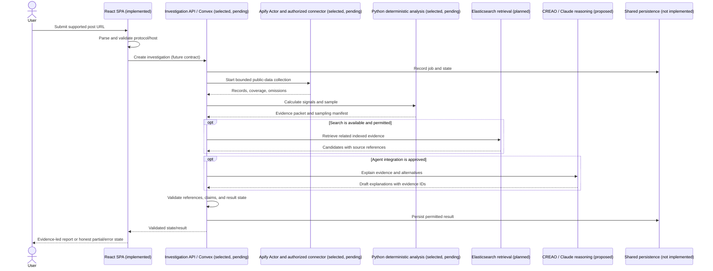
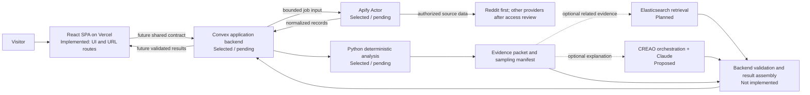

# Dead Internet Theory - Master Specification

Status: Product scope and frontend UX are specified. Architecture includes selected, planned, and proposed components whose implementation status is recorded separately. This is the project requirements baseline as of 2026-10-23; it does not certify external access, sponsor eligibility, production deployment, or analysis accuracy.

This specification fills the repository's initial TBD scaffold. Those placeholders did not establish requirements. No existing requirement is superseded, so this initial completion does not require a delta under [CONTRIBUTING.md](CONTRIBUTING.md) and [deltas/README.md](deltas/README.md).

## 1. Summary

Dead Internet Theory is a public-facing research utility for people who want to understand whether apparent agreement, recommendations, or criticism in a social media discussion may involve unusual or coordinated activity. The initial target user is someone researching a product, service, or company who wants context for social-media claims without needing to interpret behavioral data. The service should be understandable to nontechnical adults, including older users.

A user submits a supported public post URL using the homepage or URL-prefix shortcut. The intended system retrieves permitted discussion data, measures observable behaviors, compares relevant evidence, and returns a cautious plain-language report with sources, uncertainty, and limitations. The product reports signals; it does not establish intent or prove that an account is a bot, a company paid for activity, or a discussion was manipulated.

**Primary domain:** `deadinternettheory.us` is intended; production ownership and deployment are unverified.

**Repository:** Git remote `origin` points to [deadinternettheory-calhacks/dead-internet-theory](https://github.com/deadinternettheory-calhacks/dead-internet-theory). This verifies the local remote configuration, not that a hosted deployment is connected.

**Current verified state:** a React/TypeScript SPA in `web/` validates a limited set of Reddit and X/Twitter hostnames, supports homepage and URL-prefix navigation, and shows an honest unavailable state. No application backend, ingestion worker, analysis code, AI integration, search index, or production deployment is present. See [Section 10](#10-frontend-and-ux-requirements) and [Section 12](#12-testing-and-validation).

## 2. Goals, scope, and non-goals

### 2.1 Goals

- Make it easy to start an investigation with a public post link.
- Explain what the system actually examined and could not access.
- Show source-backed observations before interpretation.
- Distinguish unusual signals from proof of manipulation.
- Bound collection and analysis cost, duration, and retention.
- Keep the experience calm, accessible, and usable on mobile.

### 2.2 Intended MVP (P0)

The intended first end-to-end investigation supports URL validation, platform identification, accessible post/thread retrieval, bounded public-comment collection, account sampling, limited public-history retrieval, deterministic behavioral/content analysis, evidence generation, optional retrieval of related permitted records, optional AI-assisted explanation with validation, and completed/partial/insufficient/unsupported/inaccessible/failure states.

Reddit is the intended first provider, but it is not connected. No platform may be described as working until its integration passes provider-specific and end-to-end checks. If real source access is unavailable for a judging demo, use a labeled synthetic corpus and identify it as synthetic in the app and judging materials.

### 2.3 Non-goals

- Proving an individual's or organization's intent, sponsorship, fraud, or misconduct.
- Making single-comment AI authorship the main product question.
- A general bot classifier, fake-review verifier, social-listening/sentiment dashboard, or brand-monitoring service.
- Login, social feed, chatbot, public accusation pages, or analytics dashboard in P0.
- Circumventing authentication, access controls, rate limits, source terms, or API restrictions.
- Inferring cross-platform identity from similar usernames or behavior.
- Publishing calibrated probabilities, accuracy claims, or population prevalence without a validated study.

### 2.4 Product distinctions

| Area | Question | Relationship to this product |
| --- | --- | --- |
| Bot detection | Does an account appear automated under a defined detector? | May be a signal, not the conclusion; humans and bots may both coordinate. |
| AI-text detection | Was text likely generated by a model? | Not the core question and not proof of coordination. |
| Fake-review detection | Is a review deceptive under review-specific rules? | Different evidence and domain. |
| Social listening / sentiment | What is said and how much? | Describes context but does not establish coordinated inauthentic activity. |
| Coordinated activity | Do multiple accounts show observable related behaviors inconsistent with independent activity? | Closest analysis focus; findings remain observations with alternatives. |
| Astroturfing | Is apparent grassroots support actually sponsored/coordinated advocacy? | Interpretation only when independently supported; never infer payment from this system alone. |

## 3. Users and workflows

### 3.1 User journey

1. User pastes a post URL or opens `deadinternettheory.us/<post-url>`.
2. Frontend trims and parses the URL, restricts protocol/host, and does not fetch the source in the browser.
3. A future application boundary repeats validation and creates an investigation under a future shared contract.
4. Planned orchestration records a job and requests permitted post/thread data within configured limits.
5. Ingestion preserves source links, retrieval times, and omissions, then returns normalized records under a future contract.
6. Analysis computes deterministic signals and reproducible account samples, recording sample reasons and population.
7. If access and budgets allow, ingestion retrieves limited public history. Missing/private/deleted/rate-limited data is marked unavailable, not inferred.
8. Optional retrieval searches only permitted retained data; a match is a lead, not proof.
9. Optional reasoning considers supplied evidence, contrary facts, and innocent explanations.
10. A validator rejects malformed output and references to nonexistent evidence IDs.
11. Frontend shows the post, validated result, evidence, coverage, limitations, and recovery action; absent fields stay omitted.
12. User opens the original source or returns to submit another post.

### 3.2 Sequence diagram

Only the SPA's URL parsing, local routes, static page components, and Vercel rewrite exist now. Other participants and arrows describe intended integration, not a verified runtime flow. APIs and event payloads are contract gaps (Section 6).

### 3.3 Outcomes

| Outcome | Meaning and UI behavior |
| --- | --- |
| Completed | Real validated analysis; show only supported observations, interpretations, sources, coverage, and limits. |
| Partial | Some data was analyzed; identify completed and unavailable inputs without implying full coverage. |
| Insufficient evidence | A valid run lacked enough evidence; do not convert missingness into a low-risk result. |
| Unsupported URL/platform | Explain the link cannot be checked and offer another link. |
| Inaccessible post | Private, deleted, removed, or unavailable to the authorized connector; do not guess its contents. |
| Provider unavailable | Identify the unavailable source/step and show partial or unavailable state. |
| Service failure | Human-readable recovery; keep internal errors out of the UI. |

## 4. Requirements

### 4.1 Functional requirements

- **REQ-URL-1:** accept only explicitly supported hosts and HTTP/HTTPS. Reject credentials, arbitrary schemes, unsupported hosts, explicit ports, and invalid URLs. Server consumers must validate again.
- **REQ-URL-2:** support homepage submission and URL-prefix links. Preserve post identity and relevant query parameters. Test a canonical encoded path form where the full external URL must be path-safe.
- **REQ-URL-3:** explain that unencoded browser fragments (`#...`) are not sent to the server. Do not claim raw prefix form preserves them; an encoded full source URL can preserve one.
- **REQ-URL-4:** never treat an external URL as an internal router path, trusted redirect, or browser fetch target.
- **REQ-DATA-1:** show title, author, community, time, metric, score, finding, or link only if returned by a valid source and permitted by contract.
- **REQ-DATA-2:** distinguish source observations from interpretations; each finding needs evidence references.
- **REQ-DATA-3:** report incomplete collection and missing history explicitly. Missing data is not a negative signal.
- **REQ-DATA-4:** do not claim intent, sponsorship, bot identity, or organizational attribution based only on similarity, timing, or model output.
- **REQ-STATE-1:** support pending, partial, completed, insufficient, unsupported, inaccessible, and failure states. Progress labels must track real states; no simulated completion, countdown, or synthetic score.
- **REQ-UX-1:** homepage has centered headline, labeled URL field, **Analyze Post**, visible prefix guidance/example, and a concise three-step explanation.
- **REQ-UX-2:** analysis view orders post identity, plain-language result, evidence, coverage/limitations, and return action.
- **REQ-UX-3:** source links open a validated URL in a new tab with safe link attributes.
- **REQ-ACCESS-1:** keyboard access, visible focus, programmatic labels/errors, accessible status announcements, readable contrast, and reduced-motion support.
- **REQ-ACCESS-2:** no horizontal overflow at 375px; target 375px, 768px, and 1440px. Interactive targets should generally be at least 44px.

### 4.2 Language and result hierarchy

Prefer “We found unusual activity” or “Some comments were posted close together” over “bot network detected.” Use “not proof” language. Never say “definitely fake” or “confirmed propaganda,” or accuse real users/organizations of misconduct based on weak signals.

Results order: (1) original post and source, (2) validated plain-language result, (3) up to three prioritized evidence-backed findings, (4) optional score only when meaning/direction/calibration/cutoffs are documented and validated, (5) expandable detailed evidence, (6) sampling coverage and limitations, (7) another-post action. Numeric charts require real documented data. Missing fields are omitted.

## 5. Architecture and dependencies

### 5.1 Status vocabulary

- **Implemented and verified:** code is present and the stated check ran in this repository.
- **Selected / pending:** direction is selected but integration, access, or verification is incomplete.
- **Planned:** intended future component, not yet an accepted implementation decision.
- **Proposed:** requires evaluation/approval before implementation.
- **Blocked / unresolved:** requires an external dependency or decision.

Naming a technology does not make it an integration.

### 5.2 Architecture

No provider secret may be embedded in a Vite `VITE_*` variable. Provider calls/secrets belong in a controlled server-side environment. The repo defines no application environment variable names. Integration owners must document exact names and purposes when implementing; never publish secret values here.

### 5.3 Responsibilities, rationale, and tradeoffs

| Technology | Status / responsibility | Rationale and alternatives |
| --- | --- | --- |
| React 19, TypeScript 5.8, Vite 6, Tailwind CSS 4, React Router 7, Lucide React; shadcn-style source control | **Implemented and verified** in `web/`. Own presentation, URL validation/routing, keyboard interactions, and rendering supplied props. | Small static SPA fits the current UI. It cannot hold secrets or calculate authoritative results. A server-rendered/full-stack framework is not selected. Installed versions are in `web/package.json`. |
| Vercel | **Selected / partly configured.** `web/vercel.json` rewrites all paths to the SPA entry. | Static hosting fits the client application; configuration alone does not prove a Vercel project, domain, or live deployment. `web/README.md` documents `web/` as the intended project root. Project setup, DNS, deployment, and rollback remain to verify. |
| Convex | **Selected architectural direction; pending.** Intended to create jobs, persist permitted state/results, schedule async work, and expose validated state/results. | TypeScript backend and reactive queries may simplify job-state delivery to this SPA. Queries/mutations/actions have distinct transaction/external-I/O behavior; long provider work should be asynchronous. Custom API + queue/database gives more control/portability but adds infrastructure. Supabase/Postgres may suit SQL-first needs or existing expertise. Validate limits, costs, retention, security, and deployment fit. [Convex overview](https://docs.convex.dev/understanding/overview), [queries](https://docs.convex.dev/functions/query-functions). |
| Apify | **Selected managed-ingestion direction; pending access review and implementation.** Prefer a project-owned Actor that validates input, uses permitted connectors, enforces limits, handles pagination/retries, normalizes records, and records omissions. | A custom Actor gives project control over collection and output. A third-party Actor may accelerate experiments but introduces variable quality, cost, maintenance, output, and retention. Publishing an Actor is a separate decision. Best Actor sponsor opportunity is only a potential benefit. Apify does not authorize bypassing source restrictions. [Actor input/output](https://docs.apify.com/actors/running/input-and-output), [running Actors](https://docs.apify.com/actors/running). |
| Python; NumPy, scikit-learn, NetworkX | Python analysis direction selected; implementation absent. Candidate roles: numeric summaries; evaluated similarity/clustering; account/thread/claim graphs. | Deterministic features should be testable before model interpretation. Libraries are not currently dependencies and do not validate a signal. Methods, versions, thresholds, performance, and false positives remain research decisions. |
| Elasticsearch / Agent Builder | **Planned.** Index permitted normalized records/evidence; retrieve related claims with filters and lexical/semantic/hybrid search if corpus is useful. Agent Builder may expose retrieval tools. | Adds cross-thread candidates beyond in-memory one-thread comparison. Quality depends on permitted corpus, normalization, cost, and evaluation. A match is a lead, not proof. Defer until a data basis and relevance evaluation exist. Check license/features and sponsor rules. [Agent Builder agents](https://www.elastic.co/docs/solutions/search/agent-builder/agent-builder-agents), [tools](https://www.elastic.co/docs/explore-analyze/ai-features/agent-builder/tools). |
| CREAO | **Proposed.** Consider only if it meaningfully coordinates bounded evidence gathering and validation. | Not justified as a thin prompt relay. SDK/API, tool permissions, lifecycle, data handling, and failure behavior are unverified. A direct model call or small explicit workflow may be simpler. No redundant agent framework without demonstrated need. |
| Anthropic Claude | **Proposed, not integrated.** Potentially drafts evidence-grounded explanations, alternatives, and uncertainty from a bounded packet. | Cannot create evidence, verify sources, or set unvalidated probabilities. App code must execute and validate tool calls. Compare cost, latency, privacy, retention, and output quality. [Claude tool use](https://platform.claude.com/docs/en/agents-and-tools/tool-use/overview). |

### 5.4 Integration boundaries

- Frontend handles presentation and URLs; it sends an accepted URL to a future API and makes no source fetch.
- Orchestrator revalidates, creates job state, applies limits, invokes workers, and returns validated contract data.
- Ingestion retrieves permitted sources and reports provenance/coverage; it does not interpret intent.
- Deterministic analysis calculates reproducible features and sampling; it does not allege motive.
- Search returns candidates plus references, not proof.
- AI drafts explanations from supplied data and cannot publish directly.
- Result validator verifies state, contract, evidence IDs, sources, bounds, and safe claims.

## 6. Interfaces and data contracts

[`contracts/README.md`](contracts/README.md) is canonical but currently contains only process guidance; there are no concrete contract definitions. The SPA's `UrlResult` is a local parser type, not an API schema. Do not copy it as a substitute for a shared contract.

| Interface | Expected producer -> consumer | Status |
| --- | --- | --- |
| Submitted/normalized URL | Web -> application | Parser exists; request/API absent. |
| Create/idempotency key | Web -> application | Absent; behavior must be defined. |
| Normalized post/thread/comments | Authorized ingestion -> analysis | Absent. |
| Account profile/history | Authorized ingestion -> analysis | Absent. |
| Sampling manifest | Analysis -> validator/report | Absent. |
| Evidence packet/references | Analysis/retrieval -> reasoning/validator | Absent. |
| Progress states | Orchestrator -> frontend | Absent; no live progress subscription. |
| Result/finding | Validator -> frontend | Absent; view props are not canonical schema. |
| Error/unavailable payload | Provider/orchestrator -> frontend | Absent. |

Before integration, define and validate contracts in `contracts/` for versions, requests, states, results, evidence, errors, constraints, compatibility, and validation. Identifiers must be provider-scoped; do not infer identity across platforms. Define timestamp/timezone normalization while preserving source precision where useful. Preserve source URLs and post identifiers. Distinguish missing, unavailable, withheld, empty, and zero values. Preserve provenance: source reference, retrieval time, transform/calculation, and limitation.

Define idempotent creation: repeated use of the same explicit idempotency token should not accidentally start duplicate expensive work. Specify token scope/expiry in the shared contract. Decide separately whether the same URL without a token creates a new investigation or reuses an allowed prior result. Do not silently deduplicate across users or retain URLs beyond approved policy. Version schemas and document migration for active jobs and stored results. These are contract requirements, not payload schemas. Missing contracts are a dependency, not permission to invent them in `web/` or this file.

## 7. Account selection and sampling

### 7.1 Initial configurable budget

1. Scan accessible discussion items up to a source-specific collection cap.
2. Find distinct eligible authors and compute preliminary thread signals.
3. Select approximately 15 accounts for targeted follow-up based on recorded anomaly reasons.
4. Select approximately 15 more by reproducible stratified random sampling from the eligible population.
5. Retrieve up to approximately 50 accessible recent public history items per selected account, subject to provider terms and time/cost caps.
6. Allow limited, budgeted expansion only when an identified evidence gap justifies it.

These are initial configurable engineering/research budgets, not API limits, guarantees of representativeness, or validated thresholds. Record configured and realized counts, owner, stop reasons, candidate pool size, eligibility, strata, seed, selected IDs, selection reasons, exclusions, and completion.

### 7.2 Sampling limitations

Targeted anomaly sampling deliberately enriches unusual cases and cannot estimate prevalence among all users. A random sample better describes only its eligible frame; it does not remove source-coverage bias or small-sample uncertainty. Use platform-scoped account IDs, not display names alone. If fewer than 30 accounts are eligible, examine the available set within budget and label it small/nonrepresentative rather than fabricating a target. Missing/private/deleted/rate-limited history is unavailable, not inferred. Bound history volume and age; define retention/deletion before storage.

## 8. Detection methodology

All items below are proposed research signals, not implemented results. Owners must specify calculations, data requirements, benign comparisons, and evaluation before describing a signal as meaningful.

| Signal | Measurement examples | Interpretation limits |
| --- | --- | --- |
| Repeated promotional narratives | Similar claims, phrases, or semantic representations across comments. | Shared facts, memes, copied text, or common prompts produce organic similarity. |
| Claim similarity | Documented normalized text/semantic similarity. | Similarity is not authorship, coordination, payment, or intent; thresholds need evaluation. |
| Brand concentration | Share of available account history mentioning one brand. | History is bounded/selected; enthusiasts may focus on one brand legitimately. |
| Repeated competitor criticism | Cross-brand comparison patterns in source context. | Genuine preference, experience, or news may explain it. |
| Timing correlation | Inter-arrival times, bursts, recurring synchronized activity. | Launches, news, moderation, and active communities create bursts. |
| Account/thread overlap | Repeated co-participation and graph overlap. | Overlap is common and is not proof of common ownership. |
| Shared links/referrals | Normalized outbound domains and repeated destinations. | Organic campaigns also share links; normalization must preserve source identity. |
| Account participation | Posting intervals, diversity, bounded history patterns. | No one pattern proves automation; missing history creates bias. |
| Cross-platform recurrence | Similar claims/links on separate permitted sources. | Similar usernames are not identity; coverage is incomplete. |

Every finding needs real evidence references. Separate measurable facts from interpretation. Include denominators, coverage, missingness, time window, and source limitations when material. No accuracy, calibrated probability, universal cutoff, or score is established. Keep thresholds provisional until evaluated on a labeled corpus. Any eventual score needs documented direction, components, calibration, cutoffs, uncertainty, version, and meaning in the shared analysis contract. Higher values must have one consistent meaning; never label a post real/fake.

Do not allege fraud, paid promotion, bots, or deliberate manipulation by a named user/organization from weak signals. Strong factual allegations need independently reviewed evidence and an explicit product/legal review path.

**Benign cases to test:** brand enthusiasts; product launches; viral news; community events; similar technical specifications; copied public source text; moderation/deletion; ordinary organic activity bursts.

## 9. AI investigation workflow

AI is an optional explanation layer behind deterministic analysis and validation, not an evidence collector or truth oracle.

1. Construct a bounded packet from validated source records and deterministic signals. Each item has a stable evidence ID and source reference.
2. Treat social posts, comments, profiles, pages, and retrieved records as untrusted data, including possible prompt injection. Source text cannot change system instructions or grant tools.
3. If CREAO is selected later, permit only bounded tools with allowlisted actions, validated arguments, budgets, timeouts, and recorded outputs. No unrestricted browser, shell, credential, or arbitrary network tool.
4. If Claude is used, request observations vs interpretations, contrary evidence, plausible benign explanations, unavailable inputs, and citations to supplied evidence IDs.
5. Treat model output as draft data. A deterministic validator checks the future contract, confirms every evidence ID exists, rejects invented metrics/sources, enforces limits, and prevents unsupported allegations. Invalid output becomes partial/unavailable, not a fabricated report.
6. Persist only permitted fields; retain prompts/provider output only as justified by an approved policy. Never expose credentials or hidden reasoning to the browser.
7. Record provider/model and analysis/prompt version where permitted. Review report-semantic changes with regression tests.

If a provider fails, deterministic evidence may still support an explicitly partial result if the eventual contract permits; otherwise return failure. Never synthesize a completed state. CREAO remains unresolved until its API, tools, lifecycle, data terms, and multi-step value are verified. A direct Claude tool-use call is not equivalent to CREAO orchestration.

## 10. Frontend and UX requirements

### 10.1 Visual system and hierarchy

Use the restrained research-tool direction: lowercase `dead internet theory` wordmark and subtle three-node mark; `#FAFAF8` background; `#FFFFFF` surfaces; `#202322` primary text; `#626864` secondary; `#E3E6E1` borders; `#284D43` brand; `#1F3D35` hover; `#EAF1ED` light brand; `#A86518` / `#FFF4E4` warning; `#B4443B` / `#FCEDEA` danger; `#38765B` / `#EAF5EF` success. Use Inter with system sans-serif fallback, subtle borders, sentence case, and no hacker styling, gradients, stock art, chatbot, fictitious trust claims, or marketing filler.

Homepage: shared header; centered headline/subtitle; labeled URL field; **Analyze Post**; visible prefix guidance/example; honest platform availability; restrained “Look beyond the likes.” three steps. Analysis: “Check another post”; source summary; validated result; findings/evidence; sampling coverage/limitations; analyze-another action. Missing fields are omitted; score/chart only with real documented data.

### 10.2 URL behavior and deployment routing

`web/src/url.ts` recognizes exact hosts `reddit.com`, `www.reddit.com`, `old.reddit.com`, `redd.it`, `x.com`, `www.x.com`, `twitter.com`, and `www.twitter.com`. It permits HTTP/HTTPS, rejects credentials, explicit ports, unsupported hosts, and bad URLs. This client allowlist is not backend authorization or SSRF protection. Platform labels in the current UI say checking is not available.

Homepage submission routes to `/analysis?url=...` with the URL encoded as a query value. Prefix parsing reads pathname and search, accepts nested raw external URLs, and accepts a fully percent-encoded source URL. Unencoded fragments are not sent by the browser; an encoded full source URL can preserve one. Source links open new tabs with safe `rel` attributes. The SPA does not fetch arbitrary external URLs.

`web/vercel.json` rewrites paths to `/` so the SPA can handle deep links/refresh after hosting. It does not prove that a Vercel project, `web/` project root, domain, or live route is configured. Verify those in deployment.

### 10.3 Implemented UI and limits

`web/src/` contains shared header/footer/wordmark, URL input, shortcut and platform notices, Home/About/Analysis pages, unavailable/unsupported states, and typed presentation components for verdict, score, findings, evidence, empty/error states. Their props are local view types, not backend schemas. The current analysis route renders a submitted URL and honest “service not connected” state. Loading, insufficient-data, completed-result, findings, and score components are not connected to a backend and must not be represented as real outcomes.

`web/README.md` records commands and the missing backend. No provider, API, analysis result, platform support, or production host is verified.

## 11. Security, privacy, and platform access

### 11.1 URL/network protections

Validate independently at browser and server boundaries with exact host allowlists and allowed schemes. The browser must not fetch a submitted source URL. Backend fetchers require SSRF protection: validate resolved IP destinations; reject loopback/private/link-local/reserved ranges; constrain and revalidate redirects; set timeouts, response-size and content-type limits; reject credentials and unapproved ports. A hostname allowlist alone is not sufficient. Prefer authorized provider APIs/connectors. Redirects stay within validated, application-owned destinations.

### 11.2 Provider and execution security

Keep API keys in server-side secret storage, never source control, browser bundles, client-visible `VITE_*` variables, prompts, logs, or user-facing errors. Set submission/rate/concurrency limits, collection caps, timeouts, retry rules, and provider/model budgets before public job creation. Respect pagination, retry-after/rate-limit responses, takedowns, and access denials; do not evade restrictions. Verify current source terms, API permissions, limits, data use, and sponsor rules before implementing any connector. This spec does not claim unrestricted scraping access to Reddit, X/Twitter, TikTok, or another provider.

### 11.3 AI and report safety

Treat retrieved source content as untrusted. Use strict tool allowlists and separate instructions from quoted data. Validate model output/evidence references. The model cannot promote weak signals into factual allegations. Color must not be the sole risk indicator; avoid stigmatizing or definitive language about individuals and organizations.

### 11.4 Privacy and retention

No user accounts, retention policy, privacy notice, or deletion mechanism is implemented. Before collecting histories, choose minimization rules, retention duration, deletion workflow, access controls, log redaction, and source-correction/removal process. Store only data needed for the research purpose. Do not claim consent, anonymity, or deletion behavior before it exists and is tested.

## 12. Testing and validation

### 12.1 Verified repository checks

The `web/` project uses npm and exposes `npm run lint`, `npm test`, and `npm run build`. These passed in this checkout on 2026-10-23; `npm audit` found zero vulnerabilities:

- `npm run lint` (TypeScript project check): passed.
- `npm test`: 10 URL and SPA rewrite tests passed.
- `npm run build`: passed with Vite 6.4.5.
- `npm audit`: 0 vulnerabilities at check time.

URL tests cover Reddit acceptance, unsupported host, invalid URL, unsafe protocol, query preservation, double-encoded rejection, raw nested prefix, encoded full URL, encoded fragment, malformed prefix, and Vercel rewrite configuration. They do not browser-test a deployed direct refresh. There are no backend/provider tests because those components/contracts do not exist. No screenshot/browser test at 375px, 768px, or 1440px is present. No benchmark, model evaluation, real labeled dataset, or field study has run.

### 12.2 Required validation

- **Frontend:** parser/router tests; unsafe/unsupported inputs; browser direct navigation and refresh; keyboard/screen-reader review; responsive checks at 375/768/1440; partial/empty/error states; build and Vercel preview.
- **Ingestion:** pagination, limits, dedupe, provider failures, unavailable/deleted/private posts, retries, permission boundaries.
- **Sampling:** deterministic repeatability, selection reasons, small populations, strata, unavailable histories, and selection-bias documentation.
- **Analysis:** feature unit tests; time-zone/locale edges; benign and suspicious synthetic examples; false-positive suite; threshold review.
- **Retrieval:** permissions, IDs, filters, duplicates, relevance, missing-index/query failure. Search relevance is not truth.
- **AI/validation:** valid/invalid/missing evidence IDs, adversarial source text, contradictions, unsupported claims, malformed output, timeouts, fallback.
- **Contracts/integration:** producer-consumer validation, active-job compatibility, idempotency, duplicate submission policy, state transitions, and end-to-end outcomes.
- **Deployment/security:** production route refresh; headers, secrets, SSRF/redirect validation, rate/spend limits, logs, and rollback.

### 12.3 Synthetic corpus

The following seed cases define a labeled synthetic demo corpus. They are fixtures to implement and validate, not real posts, users, investigations, thresholds, or evidence. All names/IDs and values are synthetic. The constructed label describes the author-written fixture scenario; it does not validate a real-world detector. Counts and times are fixture parameters, never product cutoffs.

| Fixture ID | Constructed label | Synthetic setup | Required test behavior |
| --- | --- | --- | --- |
| SYN-COORD-01 | Coordinated-pattern scenario | Eight fictitious accounts repeat a rare promotional sentence, share a destination link, and post within a short constructed window. | Surface measured text/link/timing observations with their synthetic evidence references; do not infer payment, bot identity, or actor motive. |
| SYN-BENIGN-LAUNCH-01 | Benign launch burst | Many fictitious accounts discuss the same announced product launch in a burst, using varied wording and personal context. | A burst alone must not produce a manipulation allegation; retain event-context alternative. |
| SYN-BENIGN-SPEC-01 | Benign shared terminology | Independent fictitious comments use the same technical phrase because the fixture supplies a common specification excerpt. | Similarity may be measured, but must not be treated as coordination without additional independent signals. |
| SYN-BENIGN-EVENT-01 | Benign scheduled community event | Fictitious community members post similar event details around a published event time. | Explain the shared event as a plausible cause of timing/content overlap. |
| SYN-INSUFFICIENT-01 | Insufficient coverage | A small synthetic discussion has fewer than 30 eligible accounts and no retrievable account histories. | Return insufficient coverage; do not invent missing histories, sample members, or replace missing values with zero. |

Implement these fixtures in a compact, versioned test/demo corpus. Mark them synthetic in the app and presentation. Tests may assert expected feature behavior, never that a real account is malicious. Synthetic examples do not establish accuracy or generalization and must not appear as real user investigations.

## 13. Implementation priorities and ownership

The repository records no individual owners. Assign people during planning; workstreams below are responsibility boundaries, not claims of completed work. All share canonical interfaces in `contracts/` and agree on integration checkpoints before parallel implementation.

### 13.1 Workstreams

| Workstream | Responsibility | Integration dependency |
| --- | --- | --- |
| Frontend and integration | UI, honest states, contract consumption, Vercel project/domain setup, end-to-end walkthrough. | Contract, backend status/result API, deployment credentials/domain verification. |
| Backend and ingestion | Convex lifecycle, Apify Actor, authorized connectors, bounded histories, sampling orchestration, provider errors, optional CREAO. | Provider authorization, contracts, secrets/budget owners, retention policy. |
| Detection research | Features, thresholds, false-positive study, evidence, reproducible test corpus, methodology copy. | Normalized records/evidence contract; review of interpretation. |
| Elastic and integration | Corpus/index plan, search ingestion, relevance, Agent Builder tools if useful, integration tests. | Permission/retention basis, adequate permitted corpus, evidence contracts. |

### 13.2 Priorities

**P0 - honest end-to-end MVP**

1. Choose and verify Reddit access approach, authorization, fields, and limits.
2. Define create, progress, normalized data, evidence, result, and error contracts in `contracts/`.
3. Implement Convex job lifecycle and secure server-side configuration, or record a replacement decision if validation fails.
4. Build bounded Apify ingestion with genuine unavailable/partial paths.
5. Implement deterministic analysis and reproducible, documented sampling.
6. Review false positives; publish no score/accuracy claims without evidence.
7. Connect frontend to canonical contracts; verify pending/partial/completed/error states, deep-link refresh, accessibility, and target widths.
8. Deploy a Vercel preview; verify routing, domain, secrets, budgets, logs, and rollback before claiming production readiness.
9. If real source access is unavailable for demo, use only labeled synthetic data and identify it as synthetic.

**P1 - after P0 evidence and data controls**

- Bluesky provider after access review; X/Twitter and TikTok only after separate access, cost, and maintenance review.
- Elasticsearch/Agent Builder after a permitted corpus exists and retrieval adds measured value.
- CREAO after evaluation shows meaningful controllable orchestration over a small explicit workflow; any model after privacy/cost/quality review.
- Expanded history, cross-thread investigations, and new visualizations only after budgets, provenance, retention, and false-positive controls.

### 13.3 Sponsor alignment (not an eligibility claim)

| Sponsor | Integration status | Potential relevance | Prize status |
| --- | --- | --- | --- |
| Apify | Selected ingestion direction; no Actor/provider in repo. | Bounded collection and transformation. | Best Actor opportunity is only a possibility; verify current rubric and whether a private/custom Actor qualifies. |
| CREAO | Proposed; no integration. | Multi-step evidence workflow if controlled and useful. | Eligibility not verified. |
| Anthropic | Proposed; no API call. | Grounded explanation/alternatives after deterministic analysis. | Eligibility not verified. |
| Elastic | Planned; no cluster/index. | Cross-thread retrieval and optional Agent Builder tools. | Verify current product, license, and event requirements. |
| Convex | Selected/pending; no app/schema. | Job state and allowed result storage/reads. | Eligibility not verified. |
| Microsoft | No role/integration evidenced. | Not defined; only consider for a real product need. | Eligibility not verified. |
| Visa | No role/integration evidenced; payments are out of scope. | Not defined. | Eligibility not verified. |

Do not add sponsor technology for name-checking. Demonstrate meaningful use and verify current official judging criteria before any prize/eligibility claim.

### 13.4 Architecture decision log

These entries capture project direction from the implementation brief and repository evidence, not successful runtime integrations. Revisit if validation fails.

| ADR | Date | Status | Decision and consequence |
| --- | --- | --- | --- |
| ADR-001 | 2026-10-23 | Selected; implemented in `web/` | React, TypeScript, Vite, Tailwind, React Router, Lucide React, Vercel SPA. Keep secrets and authoritative analysis out of browser. Versions are in `web/package.json`; deployment is unverified. |
| ADR-002 | 2026-10-23 | Selected direction; pending | Convex intended as MVP application/job backend. Validate execution limits, data retention, security, and cost before use; no code/config is present. Record a new decision before replacement. |
| ADR-003 | 2026-10-23 | Selected direction; pending access/implementation | Apify is intended managed ingestion, preferring controlled custom Actor over unverified third-party Actor. It does not permit source-policy circumvention. |
| ADR-004 | 2026-10-23 | Planned, not accepted for P0 | Consider Elastic/Agent Builder after permitted corpus and demonstrated retrieval value. A match is not proof. |
| ADR-005 | 2026-10-23 | Proposed | Evaluate CREAO/Claude for controlled evidence reasoning; do not add until integration behavior and incremental value are verified. |
| ADR-006 | 2026-10-23 | Analysis direction selected; pending | Use Python for deterministic analysis. NumPy, scikit-learn, NetworkX are candidates only, not current dependencies. |

### 13.5 Specification change history

| Date | Change | Delta |
| --- | --- | --- |
| 2026-10-23 | Replaced the initial TBD-only scaffold with this baseline, incorporating DOC-001 direction while labeling absent code/contracts. | None required: scaffold explicitly said TBDs/placeholders were not requirements. |

Future changes that conflict with an established requirement follow [CONTRIBUTING.md](CONTRIBUTING.md): propose affected sections/rationale, obtain explicit approval, create the timestamped delta, update the spec and decision log together, and preserve the historical decision. Filling a TBD or correcting an evidence-based implementation status does not itself require a delta.
