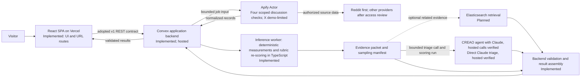

# Dead Internet Theory - Master Specification

Status: The v1.0.0 backend, website proxy and CREAO inference integration are implemented. Hosted synthetic checks and one permitted real Reddit discussion completed through ingestion, CREAO and stored analysis. Reddit is enabled with bounded collection and 24-hour application retention; other providers, broader coverage, model calibration and upstream retention controls remain unverified. See [the hosted record](backend/verification/2026-10-24-hosted-live.md).

The initial master specification filled TBD placeholders that did not establish requirements. The later v1.0.0 contract adoption supersedes draft 0.1 through the approved [contract delta](deltas/2026-10-24T05-47-50Z-astroturfing-contracts-v1.md); preserve that history and follow [CONTRIBUTING.md](CONTRIBUTING.md) and [deltas/README.md](deltas/README.md) for future changes.

## 1. Summary

Dead Internet Theory is a public-facing research utility for people who want to understand whether apparent agreement, recommendations, or criticism in a social media discussion may involve unusual or coordinated activity. The initial target user is someone researching a product, service, or company who wants context for social-media claims without needing to interpret behavioral data. The service should be understandable to nontechnical adults, including older users.

A user submits a supported public post URL using the homepage or URL-prefix shortcut. The intended system retrieves permitted discussion data, measures observable behaviors, compares relevant evidence, and returns a cautious plain-language report with sources, uncertainty, and limitations. The product reports signals; it does not establish intent or prove that an account is a bot, a company paid for activity, or a discussion was manipulated.

**Primary domain:** `deadinternettheory.us` serves the deployed website and redirects to `www.deadinternettheory.us`.

**Repository:** Git remote `origin` points to [deadinternettheory-calhacks/dead-internet-theory](https://github.com/deadinternettheory-calhacks/dead-internet-theory). This verifies the local remote configuration, not that a hosted deployment is connected.

**Current verified state:** `web/` calls the authenticated v1 API through its same-origin Vercel proxy. The Convex ingestion deployment in `backend/` collects bounded Reddit, X, TikTok and YouTube discussion data through pinned Apify Actors, stores immutable graphs and delivers ready events. X remains demo-limited by the owner's retained Free plan. The separate Convex coordinator in `inference/` calls Claude directly for triage (production selects Haiku 5.5), uses CREAO for recommendation scoring, computes scores deterministically, validates evidence and submits the analysis. A permitted 100-comment Reddit check with six sampled author-history results completed in 55.4 seconds; this discussion required no CREAO scoring. Completed link reuse across two new owners returned validated graph, analysis and histories in under a second with no additional collection or inference jobs. Application records expire after 24 hours; reuse keeps the original expiry. The owner disabled the daily Apify reservation cap while retaining $1 per run. CREAO callbacks are configured and receiver authentication passed; actual provider delivery remains unverified. CREAO's served model is not reported by the API; Claude remains the required agent configuration. These checks do not establish calibrated scores, exhaustive access or latency guarantees. See [backend/README.md](backend/README.md), [inference/README.md](inference/README.md) and the [performance verification](backend/verification/2026-10-25-url-performance.md).

## 2. Goals, scope, and non-goals

### 2.1 Goals

- Make it easy to start an investigation with a public post link.
- Explain what the system actually examined and could not access.
- Show source-backed observations before interpretation.
- Distinguish unusual signals from proof of manipulation.
- Bound collection and analysis cost, duration, and retention.
- Keep the experience calm, accessible, and usable on mobile.

### 2.2 Intended MVP (P0)

The intended first end-to-end investigation supports URL validation, platform identification, accessible post/thread retrieval, bounded public-comment collection, account sampling, limited public-history retrieval, deterministic behavioral/content analysis, evidence generation, optional retrieval of related permitted records, optional AI-assisted explanation with validation, and completed/partial/insufficient/unsupported/inaccessible/failure states.

Reddit is the first enabled provider, with scoped Actor checks and one hosted real-post flow verified. No platform may be described as working until its integration passes provider-specific and end-to-end checks. If real source access is unavailable for a judging demo, use a labeled synthetic corpus and identify it as synthetic in the app and judging materials.

### 2.3 Non-goals

- Proving an individual's or organization's intent, sponsorship, fraud, or misconduct.
- Making single-comment AI authorship the main product question.
- A general bot classifier, fake-review verifier, social-listening/sentiment dashboard, or brand-monitoring service.
- Login, social feed, chatbot, public accusation pages, or analytics dashboard in P0.
- Circumventing authentication, access controls, rate limits, source terms, or API restrictions.
- Inferring cross-platform identity from similar usernames or behavior.
- Publishing calibrated probabilities, accuracy claims, or population prevalence without a validated study.

### 2.4 Product distinctions

| Area | Question | Relationship to this product |
| --- | --- | --- |
| Bot detection | Does an account appear automated under a defined detector? | May be a signal, not the conclusion; humans and bots may both coordinate. |
| AI-text detection | Was text likely generated by a model? | Not the core question and not proof of coordination. |
| Fake-review detection | Is a review deceptive under review-specific rules? | Different evidence and domain. |
| Social listening / sentiment | What is said and how much? | Describes context but does not establish coordinated inauthentic activity. |
| Coordinated activity | Do multiple accounts show observable related behaviors inconsistent with independent activity? | Closest analysis focus; findings remain observations with alternatives. |
| Astroturfing | Is apparent grassroots support actually sponsored/coordinated advocacy? | Interpretation only when independently supported; never infer payment from this system alone. |

## 3. Users and workflows

### 3.1 User journey

1. User pastes a post URL or opens `deadinternettheory.us/<post-url>`.
2. Frontend trims and parses the URL, restricts protocol/host, and does not fetch the source in the browser.
3. The future application API repeats validation and creates an investigation using the adopted v1 contract; no API implementation is present.
4. Planned orchestration records a job and requests permitted post/thread data within configured limits.
5. Ingestion preserves source links, retrieval times, and omissions, then returns a normalized immutable graph under the adopted GraphEnvelope contract.
6. Analysis computes deterministic signals and reproducible account samples, recording sample reasons and population.
7. If access and budgets allow, ingestion retrieves limited public history. Missing/private/deleted/rate-limited data is marked unavailable, not inferred.
8. Optional retrieval searches only permitted retained data; a match is a lead, not proof.
9. Optional reasoning considers supplied evidence, contrary facts, and innocent explanations.
10. A validator rejects malformed output and references to nonexistent evidence IDs.
11. Frontend shows the post, validated result, evidence, coverage, limitations, and recovery action; absent fields stay omitted.
12. User opens the original source or returns to submit another post.

### 3.2 Sequence diagram

```mermaid
sequenceDiagram
    actor User
    participant Web as React SPA (implemented)
    participant App as Investigation API / Convex (implemented; hosted)
    participant Ingest as Apify Actor and authorized connector (selected, pending; synthetic stand-in)
    participant Analyze as Inference worker in Convex: deterministic scoring (implemented)
    participant Search as Elasticsearch retrieval (planned)
    participant Agent as Claude (triage, direct API; hosted verified) and CREAO agent with Claude required (hosted calls verified)
    participant Store as Convex database (implemented; 24-hour application retention)
    User->>Web: Submit supported post URL
    Web->>Web: Parse and validate protocol/host
    Web->>App: POST /v1/investigations + Idempotency-Key
    App->>Store: Queue idempotent job and record state
    App->>Ingest: Start bounded public-data collection
    Ingest-->>App: Validate/store immutable graph + coverage
    App-->>Analyze: investigation.ready (at least once)
    Analyze->>App: GET graph; select authors and anchors
    Analyze->>App: POST enrichment job (optional)
    App->>Ingest: Collect Reddit/X history candidates
    Ingest-->>App: Ten-item samples and per-author outcomes
    Analyze->>Analyze: Analyze graph and available enrichment
    Analyze->>App: POST analysis with graph revision/fingerprint
    opt Search is available and permitted
      App->>Search: Retrieve related indexed evidence
      Search-->>App: Candidates with source references
    end
    opt Agent integration is approved
      App->>Agent: Explain evidence and alternatives
      Agent-->>App: Draft explanations with evidence IDs
    end
    App->>App: Validate contract references and state
    App->>Store: Persist permitted result
    App-->>Web: Validated state/result
    Web-->>User: Evidence-led report or honest partial/error state
```

The SPA, the Convex ingestion backend (v1 routes, jobs, `investigation.ready` delivery over HTTPS) and the separate inference service (event receiver, CREAO triage, enrichment request, CREAO rubric scoring, deterministic re-scoring, validated submission) exist and have run together locally in fixture mode with recorded CREAO replies. Hosted Reddit, X, TikTok and YouTube ingestion, CREAO calls, frontend proxy authentication and analysis persistence are verified for scoped checks. X remains limited by the current Apify Free-plan quotas. Broader live history coverage and Elasticsearch remain unverified or unimplemented; see the [four-platform hosted record](backend/verification/2026-10-24-four-platform-hosted.md). V1 routes and event models are defined in Section 6.

### 3.3 Outcomes

| Outcome | Meaning and UI behavior |
| --- | --- |
| Completed | Real validated analysis; show only supported observations, interpretations, sources, coverage, and limits. |
| Partial | Some data was analyzed; identify completed and unavailable inputs without implying full coverage. |
| Insufficient evidence | A valid run lacked enough evidence; do not convert missingness into a low-risk result. |
| Unsupported URL/platform | Explain the link cannot be checked and offer another link. |
| Inaccessible post | Private, deleted, removed, or unavailable to the authorized connector; do not guess its contents. |
| Provider unavailable | Identify the unavailable source/step and show partial or unavailable state. |
| Service failure | Human-readable recovery; keep internal errors out of the UI. |

## 4. Requirements

### 4.1 Functional requirements

- **REQ-URL-1:** accept only explicitly supported hosts and HTTP/HTTPS. Reject credentials, arbitrary schemes, unsupported hosts, explicit ports, and invalid URLs. Server consumers must validate again.
- **REQ-URL-2:** support homepage submission and URL-prefix links. Preserve post identity and relevant query parameters. Test a canonical encoded path form where the full external URL must be path-safe.
- **REQ-URL-3:** explain that unencoded browser fragments (`#...`) are not sent to the server. Do not claim raw prefix form preserves them; an encoded full source URL can preserve one.
- **REQ-URL-4:** never treat an external URL as an internal router path, trusted redirect, or browser fetch target.
- **REQ-DATA-1:** show title, author, community, time, metric, score, finding, or link only if returned by a valid source and permitted by contract.
- **REQ-DATA-2:** distinguish source observations from interpretations; each finding needs evidence references.
- **REQ-DATA-3:** report incomplete collection and missing history explicitly. Missing data is not a negative signal.
- **REQ-DATA-4:** do not claim intent, sponsorship, bot identity, or organizational attribution based only on similarity, timing, or model output.
- **REQ-STATE-1:** support pending, partial, completed, insufficient, unsupported, inaccessible, and failure states. Progress labels must track real states; no simulated completion, countdown, or synthetic score.
- **REQ-UX-1:** homepage has centered headline, labeled URL field, **Analyze Post**, visible prefix guidance/example, and a concise three-step explanation.
- **REQ-UX-2:** analysis view orders post identity, plain-language result, evidence, coverage/limitations, and return action.
- **REQ-UX-3:** source links open a validated URL in a new tab with safe link attributes.
- **REQ-ACCESS-1:** keyboard access, visible focus, programmatic labels/errors, accessible status announcements, readable contrast, and reduced-motion support.
- **REQ-ACCESS-2:** no horizontal overflow at 375px; target 375px, 768px, and 1440px. Interactive targets should generally be at least 44px.

### 4.2 Language and result hierarchy

Prefer “We found unusual activity” or “Some comments were posted close together” over “bot network detected.” Use “not proof” language. Never say “definitely fake” or “confirmed propaganda,” or accuse real users/organizations of misconduct based on weak signals.

Results order: (1) original post and source, (2) validated plain-language result, (3) up to three prioritized evidence-backed findings, (4) the comment-section astroturfing index (0–100) with its meaning, direction and bands documented (ADR-010); it is not validated, (5) expandable detailed evidence, (6) sampling coverage and limitations, (7) another-post action. Numeric charts require real documented data. Missing fields are omitted.

## 5. Architecture and dependencies

### 5.1 Status vocabulary

- **Implemented and verified:** code is present and the stated check ran in this repository.
- **Selected / pending:** direction is selected but integration, access, or verification is incomplete.
- **Planned:** intended future component, not yet an accepted implementation decision.
- **Proposed:** requires evaluation/approval before implementation.
- **Blocked / unresolved:** requires an external dependency or decision.

Naming a technology does not make it an integration.

### 5.2 Architecture



No provider secret may be embedded in a Vite `VITE_*` variable. Provider calls/secrets belong in a controlled server-side environment. The repo defines no application environment variable names. Integration owners must document exact names and purposes when implementing; never publish secret values here.

### 5.3 Responsibilities, rationale, and tradeoffs

| Technology | Status / responsibility | Rationale and alternatives |
| --- | --- | --- |
| React 19, TypeScript 5.8, Vite 6, Tailwind CSS 4, React Router 7, Lucide React; shadcn-style source control | **Implemented and verified** in `web/`. Own presentation, URL validation/routing, keyboard interactions, and rendering supplied props. | Small static SPA fits the current UI. It cannot hold secrets or calculate authoritative results. A server-rendered/full-stack framework is not selected. Installed versions are in `web/package.json`. |
| Vercel | **Selected / partly configured.** `web/vercel.json` rewrites all paths to the SPA entry. | Static hosting fits the client application; configuration alone does not prove a Vercel project, domain, or live deployment. `web/README.md` documents `web/` as the intended project root. Project setup, DNS, deployment, and rollback remain to verify. |
| Convex | **Implemented; hosted scoped flow verified.** Two deployments: the ingestion backend in `backend/` (v1 API, durable jobs, event delivery; see [backend/README.md](backend/README.md)) and the inference service in `inference/` (event inbox and a scheduler-driven worker; see [inference/README.md](inference/README.md)). | TypeScript backend and reactive queries may simplify job-state delivery to this SPA. Queries/mutations/actions have distinct transaction/external-I/O behavior; long provider work should be asynchronous. Custom API + queue/database gives more control/portability but adds infrastructure. Supabase/Postgres may suit SQL-first needs or existing expertise. Validate limits, costs, retention, security, and deployment fit. [Convex overview](https://docs.convex.dev/understanding/overview), [queries](https://docs.convex.dev/functions/query-functions). |
| Apify | **All four discussion adapters have scoped runtime checks; X remains limited by Apify Free-plan quotas.** Prefer a project-owned Actor that validates input, uses permitted connectors, enforces limits, handles pagination/retries, normalizes records, and records omissions. The merged provider-adapter document also lists third-party Actor candidates for discussion/history collection; choosing between those candidates and a custom Actor, and validating terms and actual behavior, remains open. | A custom Actor gives project control over collection and output. A third-party Actor may accelerate experiments but introduces variable quality, cost, maintenance, output, and retention. Publishing an Actor is a separate decision. Best Actor sponsor opportunity is only a potential benefit. Apify does not authorize bypassing source restrictions. [Actor input/output](https://docs.apify.com/actors/running/input-and-output), [running Actors](https://docs.apify.com/actors/running). |
| Python; NumPy, scikit-learn, NetworkX | **Superseded for the inference worker** by TypeScript inside Convex (ADR-008). Remain candidates for later research analysis; implementation absent. Candidate roles: numeric summaries; evaluated similarity/clustering; account/thread/claim graphs. | Deterministic features should be testable before model interpretation. Libraries are not currently dependencies and do not validate a signal. Methods, versions, thresholds, performance, and false positives remain research decisions. |
| Elasticsearch / Agent Builder | **Planned.** Index permitted normalized records/evidence; retrieve related claims with filters and lexical/semantic/hybrid search if corpus is useful. Agent Builder may expose retrieval tools. | Adds cross-thread candidates beyond in-memory one-thread comparison. Quality depends on permitted corpus, normalization, cost, and evaluation. A match is a lead, not proof. Defer until a data basis and relevance evaluation exist. Check license/features and sponsor rules. [Agent Builder agents](https://www.elastic.co/docs/solutions/search/agent-builder/agent-builder-agents), [tools](https://www.elastic.co/docs/explore-analyze/ai-features/agent-builder/tools). |
| CREAO | **Selected (ADR-008) as the agent platform for inference; hosted synthetic and one real-post flow verified.** CREAO hosts the agent and runs it on Claude (below). The CREAO agent runs rubric scoring (which rules fire, with cited IDs) and, when no Anthropic key is configured, triage (subject, stance, recommendations). The worker can pass a webhook URL so CREAO reports finished runs instead of waiting for the next poll (ADR-009). Supports app-scoped `capi_` keys and `cr_sk_` developer keys; agent setup is in [inference/creao-agent.md](inference/creao-agent.md). | The agent gets no tools and is told evidence is untrusted data. Its replies are parsed, schema-checked and re-scored deterministically; it cannot set numbers or add evidence. Data handling, retention and cost terms of CREAO and its underlying model still need review. [API Trigger docs](https://docs.creao.ai/pro/api-trigger). |
| Anthropic Claude | **Selected (ADR-008, ADR-009) as the inference model.** Triage calls the Anthropic Messages API directly when `ANTHROPIC_API_KEY` is set on the inference deployment: one request with structured outputs (default `claude-opus-5-5` at low effort, `ANTHROPIC_MODEL` to change it). Scoring runs through CREAO, whose agent model must be a Claude model: set it in the agent's settings on agent.creao.ai for app-scoped keys, or with `CREAO_MODEL` (for example `anthropic/claude-sonnet-5-5`, CREAO's developer-API default) for `cr_sk_` keys. CREAO's run API did not report which model served the verified runs, so confirm the agent's model setting. | Claude classifies comments and proposes rubric signals; it cannot create evidence, verify sources, or set scores. The worker re-validates every reply and computes all scores deterministically. Review CREAO's and Anthropic's data handling, retention and cost for inference traffic. |

Repeated source links reuse a retained result or join in-flight work for the same platform/native post ID, collection configuration and cache epoch. Each browser keeps a separate owner-scoped view; views consistently derive graph fingerprints and analysis/history identifiers without duplicating source content or starting another scraper/model run. Cache hits retain the original work timestamps and fixed 24-hour expiry. Expired, removed or incomplete evidence prevents reuse. Reddit history collection bounds retained bytes per author, adaptively pages oversized responses, and preserves valid partial evidence from interrupted runs while reporting omissions.

### 5.4 Integration boundaries

- Frontend handles presentation and URLs and makes no source fetch. It calls the v1 REST API through the site's same-origin proxy (`/api/v1/*`), because the backend requires bearer JWTs and allows no browser cross-origin access. The proxy forwards only frontend routes and mints five-minute `frontend` JWTs whose subject is an anonymous per-browser session (HttpOnly cookie), so the backend's owner check scopes reads to the visitor's own investigations. Its signing secret is a server-side Vercel variable.
- The ingestion backend implements the v1 REST boundary, revalidates, creates job state, invokes Apify, persists the graph, and emits investigation.ready. The inference worker consumes that event, reads the graph, selects authors/anchors, requests enrichment, and submits an evidence-backed analysis. The backend delivers `investigation.ready` by authenticated HTTPS POST to the inference service, which deduplicates it durably and calls the REST API with inference-role JWTs scoped to one investigation (see [backend/INTEGRATION.md](backend/INTEGRATION.md)).
- Ingestion retrieves permitted sources and reports provenance/coverage; it does not interpret intent.
- Inference owns author/anchor selection and interpretation; ingestion owns history candidate collection/sampling under the v1 algorithm. The rubric remains a proposal, not an implemented deterministic analysis. Neither role establishes motive.
- Search returns candidates plus references, not proof.
- AI (Claude, called directly for triage and running as the CREAO agent for scoring) classifies comments and proposes rubric signals from supplied data; it cannot publish directly. The worker submits only after deterministic re-scoring and contract validation, through the same internal functions as the REST routes.
- Result validator verifies state, contract, evidence IDs, sources, bounds, and safe claims.

## 6. Interfaces and data contracts

The v1.0.0 bundle is the canonical interface design, adopted for repository implementation but not yet accepted by separate backend/inference owners or verified against live providers. Read the definitions directly; this section summarizes requirements without duplicating schemas:

- [Discussion Graph and Enrichment API](contracts/discussion-graph-api.md) defines lifecycle, ownership, sampling, graph invariants, errors, and compatibility.
- [models.schema.json](contracts/models.schema.json) is the canonical JSON Schema Draft 2020-12 model source; [openapi.yaml](contracts/openapi.yaml) defines OpenAPI 3.1 HTTP routes.
- [Provider adapter notes](contracts/provider-adapters.md) document candidate Apify Actor mappings only; no authenticated production Actor runs are verified.
- [Synthetic fixtures](contracts/examples/README.md) are fabricated contract examples. [validate_contracts.py](scripts/validate_contracts.py) checks schemas, fixtures, OpenAPI references, and selected invariants; it is not a live integration test.

The contract covers one public discussion URL per investigation on Reddit, X/Twitter, YouTube, or TikTok. It specifies asynchronous REST operations: POST /v1/investigations returns 202; clients poll the investigation resource; graph reads wait for ingestion; enrichment POST returns 202; analysis POST returns 201 for a matching graph revision/fingerprint; GET retrieves persisted analysis; GET /v1/capabilities returns capability hints, not a guarantee of successful collection. The backend dispatches investigation.ready internally to inference. Apify callbacks/polling are internal details.

The v1 graph has one discussion root, platform-scoped discussion/author/comment IDs, typed reply/authorship edges, coverage and provenance, and is immutable per graph revision. Enrichment is requested by inference using author/anchor pairs. V1 allows 1-25 pairs per request and requests exactly 10 returned history comments per pair, using the defined temporal-nearest or full most-recent fallback algorithm. Candidate collection targets up to 150 public authored comments per author. Only Reddit and X author histories are supported; YouTube and TikTok return unsupported without a provider request. Five per-author outcomes are explicit: complete, partial, unavailable, unsupported, failed. These are API semantics, not claims that any provider works.

AnalysisSubmission requires the graph revision and fingerprint, inference version, typed subject/sentiment/axis/comment/cluster/evidence data, overallCoordinationRisk (0-100 heuristic index or null), analysis-only inferred edges, used enrichment IDs, and limitations. Scores are indices, not calibrated probabilities; model confidence is not statistical confidence. Evidence references must resolve to graph or referenced enrichment records. Missing values are not zero.

All POST operations require Idempotency-Key (8-128 ASCII characters), scoped to authenticated principal and route for 24 hours; identical retries replay, changed bodies conflict. V1 uses schemaVersion 1.0.0, /v1 routes, stable error envelopes/statuses, optional response-field compatibility, and /v2 for breaking changes. Auth roles distinguish frontend create from inference enrichment/analysis; secrets remain server-side. See the canonical files for exact fields and behavior.

Contract adoption supersedes draft 0.1, but does not establish runtime implementation, team-owner acceptance, provider authorization, Actor correctness, deployment size limits, or rubric-to-axis mapping. The local frontend UrlResult remains a parser type, not an API schema; the UI is not yet connected to these contracts.

## 7. Account selection and sampling

### 7.1 Inference selection and v1 enrichment limits

The earlier research plan of approximately 15 targeted plus 15 stratified candidate accounts remains a configurable sampling proposal; it does not override the v1 wire limits. Inference chooses authors and anchor comments. The implemented design (ADR-010) requests histories for a seeded random sample rather than every user: up to 6 supportive and up to 6 unsupportive users (critical or mixed, filled with neutral users), plus the post author if they commented, reproducible per investigation and graph revision; the analysis records each group's population and sample size. A v1 EnrichmentRequest carries 1-25 author/anchor pairs, each requests exactly 10 history items, and only Reddit/X histories are supported. YouTube/TikTok author-history requests return unsupported without calling a provider.

For Reddit/X, ingestion may collect a best-effort candidate pool of up to 150 public authored comments per author (`HISTORY_CANDIDATES_PER_AUTHOR`, default 40, with history rows slimmed to the fields mapping uses so a full batch fits the snapshot budget). It excludes the focal discussion and anchor, deduplicates by provider comment ID, and uses the contract algorithm: return the 10 nearest items when at least 10 usable candidates fall within the configured anchor window; otherwise replace that sample with the 10 most recent available candidates. Per-author status is complete only when 10 items are returned, not when lifetime history is exhaustive; partial, unavailable, unsupported, and failed outcomes are explicit. Exact tie-breaking, timestamp handling, strategy values, and coverage definitions are in [discussion-graph-api.md](contracts/discussion-graph-api.md).

These are contract-defined collection/sampling budgets, not validated statistical guarantees. A selected anomaly-enriched sample is nonprobability sampling and cannot estimate prevalence. Record candidate-pool coverage, sample design, selection reasons, missingness, and limitations. Fewer than 30 eligible discussion authors remains a small, nonrepresentative set; missing histories are not zero or evidence of no activity. Any extension beyond the v1 ten-item result or 25-pair request requires a contract change.

## 8. Detection methodology

These remain proposed research signals, not validated results. The inference service in `inference/` computes some of them deterministically (timing bursts, word overlap, tracking links, brand mentions in histories, account age) and passes them to the CREAO agent as facts for the rubric; this implements the signals but does not validate them.

| Signal | Measurement examples | Interpretation limits |
| --- | --- | --- |
| Repeated promotional narratives | Similar claims, phrases, or semantic representations across comments. | Shared facts, memes, copied text, or common prompts produce organic similarity. |
| Claim similarity | Documented normalized text/semantic similarity. | Similarity is not authorship, coordination, payment, or intent; thresholds need evaluation. |
| Brand concentration | Share of available account history mentioning one brand. | History is bounded/selected; enthusiasts may focus on one brand legitimately. |
| Repeated competitor criticism | Cross-brand comparison patterns in source context. | Genuine preference, experience, or news may explain it. |
| Timing correlation | Inter-arrival times, bursts, recurring synchronized activity. | Launches, news, moderation, and active communities create bursts. |
| Account/thread overlap | Repeated co-participation and graph overlap. | Overlap is common and is not proof of common ownership. |
| Shared links/referrals | Normalized outbound domains and repeated destinations. | Organic campaigns also share links; normalization must preserve source identity. |
| Account participation | Posting intervals, diversity, bounded history patterns. | No one pattern proves automation; missing history creates bias. |
| Cross-platform recurrence | Similar claims/links on separate permitted sources. | Similar usernames are not identity; coverage is incomplete. |

Every finding needs real evidence references resolving to the graph or a history job referenced by usedEnrichmentIds. Separate measurements from interpretation and include population, sampling method, coverage, missingness, time window, and limitations. Contract scores are heuristic indices, not probabilities; axis score null means insufficient evidence/no measurement, and confidence is not statistical confidence. No calibration, validated cutoff, accuracy, or prevalence claim exists. The proposed [product astroturfing rubric](rubrics/product-astroturfing.md) is hand-weighted, unvalidated, and not the AnalysisSubmission wire payload. A provisional, explicit mapping of its rules to contract axes is implemented and documented in [inference/README.md](inference/README.md#provisional-rubric-mapping); it requires evaluation. `overallCoordinationRisk` is a comment-section index (ADR-010, ADR-013, ADR-015) combining comment realism, low-effort support, coordination (clusters and copied praise), commercial signals, rubric strength and the history contrast between the random supportive and unsupportive samples, with fixed weights renormalized over the measured parts; one-sided support is a small bonus. Each sampled account with a history also gets an automation-signal index (ADR-012): the share of evaluable rubric family-B points that fired (brand focus, repeated recommendations, engagement farming, new or reactivated account, style shift, shift-like schedule, one-sided sentiment, LLM-style writing, hidden history), proposed by the model (a dedicated Claude history review when configured, otherwise the CREAO scoring response) and re-scored deterministically, with brand focus and account age measured directly. It is attached to the account's anchor comment as `commentAssessments[].accountSignals`, is an uncalibrated index of observed signals, and is never presented as a probability that an account is a bot. When the history shows an ordinary human user (rubric E2 established account, E4 recognized community member, E7 criticized the brand elsewhere; E2 is also measured: over a year old, 3+ communities, at most one product mention, full history), no automation signals are reported for that account and its score is 0 (`accountSignals.humanSignals`). Until then, scores are uncalibrated heuristic indices. Per ADR-011, the UI and analysis text carry no per-item caveats; one site-wide footer warning (“Dead Internet can make mistakes.”) covers every result, and the documentation records the limits. Never label a post real/fake.

Do not allege fraud, paid promotion, bots, or deliberate manipulation by a named user/organization from weak signals. Strong factual allegations need independently reviewed evidence and an explicit product/legal review path. Outstanding decisions include backend/inference owner acceptance, live provider verification, deployment graph-size limits, mapping the proposed rubric to contract axes, and runtime integration.

**Benign cases to test:** brand enthusiasts; product launches; viral news; community events; similar technical specifications; copied public source text; moderation/deletion; ordinary organic activity bursts.

## 9. AI investigation workflow

AI is an optional explanation layer behind deterministic analysis and validation, not an evidence collector or truth oracle.

1. Construct a bounded packet from validated source records and deterministic signals. Each item has a stable evidence ID and source reference.
2. Treat social posts, comments, profiles, pages, and retrieved records as untrusted data, including possible prompt injection. Source text cannot change system instructions or grant tools.
3. Inference uses Claude and CREAO (ADR-008, ADR-009): triage is one direct Claude call with a schema-constrained reply when an Anthropic key is configured. After history collection, a focused direct Claude task reviews every supplied account history, even without product recommendations; complete, unique author coverage is validated. Recommendation scoring runs on a CREAO agent whose model is Claude. Neither is granted tools; the CREAO agent's prompt forbids browsing, code and integrations. Validated replies are cached by stage, prompt version, model and exact evidence for 24 hours; the account task also has its own version. It reuses collected histories and starts no additional scraping. Each run has a 256 KB input cap (packets are bounded to 180 KB) and a 15-minute stage limit. Any future tool must be allowlisted with validated arguments, budgets, timeouts and recorded outputs.
4. The Claude prompts request observations vs interpretations, contrary evidence, plausible benign explanations, unavailable inputs, and citations to supplied graph/history evidence IDs.
5. Treat model output as draft data. A deterministic validator checks the AnalysisSubmission contract, confirms every evidence ID exists in the graph or referenced enrichment, rejects invented metrics/sources, enforces limits, and prevents unsupported allegations. Invalid output becomes partial/unavailable, not a fabricated report.
6. Persist only permitted fields; retain prompts/provider output only as justified by an approved policy. Never expose credentials or hidden reasoning to the browser.
7. Record provider/model and analysis/prompt version where permitted. Review report-semantic changes with regression tests.

If a provider fails, deterministic evidence may still support an explicitly partial result if the eventual contract permits; otherwise return failure. Never synthesize a completed state. In this implementation, a Claude or CREAO failure, refusal or unparseable reply (after up to three attempts) marks the analysis failed; no deterministic-only partial report is stored, because the contract has no partial flag. CREAO data terms, retention and cost remain to verify.

## 10. Frontend and UX requirements

### 10.1 Visual system and hierarchy

Use the restrained research-tool direction: lowercase `dead internet theory` wordmark and subtle three-node mark; `#FAFAF8` background; `#FFFFFF` surfaces; `#202322` primary text; `#626864` secondary; `#E3E6E1` borders; `#284D43` brand; `#1F3D35` hover; `#EAF1ED` light brand; `#A86518` / `#FFF4E4` warning; `#B4443B` / `#FCEDEA` danger; `#38765B` / `#EAF5EF` success. Use Inter with system sans-serif fallback, subtle borders, sentence case, and no hacker styling, gradients, stock art, chatbot, fictitious trust claims, or marketing filler.

Homepage: shared header; centered headline/subtitle; labeled URL field; **Analyze Post**; visible prefix guidance/example; honest platform availability; restrained “Look beyond the likes.” three steps. Analysis: “Check another post”; source summary; validated result; findings/evidence; sampling coverage/limitations; analyze-another action. Missing fields are omitted; score/chart only with real documented data.

### 10.2 URL behavior and deployment routing

`web/src/url.ts` recognizes exact hosts `reddit.com`, `www.reddit.com`, `old.reddit.com`, `redd.it`, `x.com`, `www.x.com`, `twitter.com`, `www.twitter.com`, `youtube.com`, `www.youtube.com`, `m.youtube.com`, `youtu.be`, `tiktok.com`, `www.tiktok.com`, `vm.tiktok.com`, and `vt.tiktok.com`. Mobile YouTube hosts normalize to `www.youtube.com`. It permits HTTP/HTTPS, rejects credentials, explicit ports, unsupported hosts, and bad URLs. This client allowlist is not backend authorization or SSRF protection. The form lists all four platforms and reads live availability from `/v1/capabilities`; recognizing a link does not bypass backend provider verification. TikTok full video URLs and share links are accepted; the server proxy resolves shares through bounded, DNS-validated/pinned HEAD requests to exact TikTok hosts and revalidates every redirect before handing the full video URL to the backend. X is labeled as a limited demo when its Free-plan quotas apply.

Homepage submission routes to `/analysis?url=...` with the URL encoded as a query value. Prefix parsing reads pathname and search, accepts nested raw external URLs, and accepts a fully percent-encoded source URL. Unencoded fragments are not sent by the browser; an encoded full source URL can preserve one. Source links open new tabs with safe `rel` attributes. The SPA does not fetch arbitrary external URLs.

`web/vercel.json` rewrites paths to `/` so the SPA can handle deep links/refresh after hosting. It does not prove that a Vercel project, `web/` project root, domain, or live route is configured. Verify those in deployment.

### 10.3 Implemented UI and limits

The homepage includes an original animated wireframe globe with modeled
gravestones as a decorative illustration. It rotates, floats and responds to
pointer movement, with a visible Pause/Play control. Dragging turns the globe;
a release flick adds bounded angular velocity with frame-rate-independent
friction. Re-grabbing stops momentum. Horizontal touch swipes preserve vertical
page scrolling and pinch zoom; arrow keys turn the focused globe and Home resets
its orientation. Pause stops automatic motion and inertia while permitting
direct turns. Reduced motion starts with a static SVG poster; graphics failure
also retains the poster and working form.
The 3D code is loaded separately and animation stops offscreen or in hidden tabs.

`web/src/` contains shared header/footer/wordmark, URL input, shortcut and platform notices, Home/About/Analysis pages, unavailable/unsupported states, and typed presentation components for verdict, score, findings, evidence, empty/error states. Their props are local view types, not backend schemas. Until the proxy has backend credentials, the analysis route renders the submitted URL and an honest “service not connected” state. When the proxy has backend credentials (`BACKEND_BASE_URL`, `BACKEND_JWT_SECRET`), the route creates a v1 investigation, shows progress text that tracks the real `ingestionStatus`/`analysisStatus`, and renders the stored analysis via `src/analysis/report.ts` (post, verdict, up to three findings in the moderate band or above with quoted evidence, detailed signals, coverage and limitations), or a specific failure state. The comment-section astroturfing index appears prominently with documented bands (ADR-010); its rationale appears in the detailed analysis. `/example` renders a real TikTok product video's comment section with usernames replaced by made-up names of the same kind and comment IDs replaced, analyzed with recorded live Claude and CREAO replies (ADR-011, ADR-016); it links to the original video but not to individual comments.

`web/README.md` records commands and API configuration. The hosted site and API completed a permitted Reddit analysis through CREAO; the example replays a stored, anonymized real thread and never calls the live scraper. The contract platform enum lists Reddit, X, YouTube, and TikTok; that is interface scope, not proof of integration.

The homepage also offers an animated preview of the example thread and three
steps explaining the workflow. `/example` now provides a guided five-scene
walkthrough with Play, Pause, Replay, direct step selection and a complete-report
option. It is a replay of a completed analysis and never starts live collection. Reduced motion starts manually; evidence interaction and hidden
tabs pause playback. Native view transitions animate the decorative globe between
home and example where supported, with ordinary navigation as the fallback.

Account rows retain unavailable-check counts and sampled history size. An incomplete zero is displayed as a limited assessment; a completed review with no observed signals may still score zero.

Completed reports include selectable comment, literal-phrase, UTC timestamp and
bounded history-sample views. Maps represent discussion membership or exact phrase
matches; they do not infer account relationships. Visuals disclose their limit of
12 displayed comments, prioritizing cited evidence when relevant. Missing times
and unavailable histories remain explicit. Live waiting views follow actual
backend states, show elapsed time in the view, and let readers browse a bounded
preview of collected comments while analysis runs. They do not use the synthetic
walkthrough's timing, invented percentages or an estimated completion countdown.

Live waiting views use a fixed, full-viewport 3D background with no visible
scene-control buttons: a graveyard globe and illustrative comment tiles fill the
page while a rounded, expressive ghost roams within the visible viewport. Actual
backend phases drive the formations: resting orbit while queued, gathering cards
during collection, and an organized field with a magnifying glass during analysis.
The ghost waves, blinks, reaches, nods and reacts to taps with hops, winks and
twirls. Reactions finish before accepting another; rapid clicks never toggle
pause. Drag/flick and keyboard interactions remain available, with Space to
pause/resume and Escape to pause. Foreground text, navigation and collected
comments remain readable and usable. The art never represents collected evidence
or invented progress. Reduced motion, graphics fallback, hidden-tab suspension
and deferred lazy loading keep the real investigation usable independently of
the scene. Scrolling or a backend phase change does not suspend animation. See
[web/README.md](web/README.md#interactive-analysis-playground).

## 11. Security, privacy, and platform access

### 11.1 URL/network protections

Validate independently at browser and server boundaries with exact host allowlists and allowed schemes. The browser must not fetch a submitted source URL. Backend fetchers require SSRF protection: validate resolved IP destinations; reject loopback/private/link-local/reserved ranges; constrain and revalidate redirects; set timeouts, response-size and content-type limits; reject credentials and unapproved ports. A hostname allowlist alone is not sufficient. Prefer authorized provider APIs/connectors. Redirects stay within validated, application-owned destinations.

### 11.2 Provider and execution security

Keep API keys in server-side secret storage, never source control, browser bundles, client-visible `VITE_*` variables, prompts, logs, or user-facing errors. Set submission/rate/concurrency limits, collection caps, timeouts, retry rules, and provider/model budgets before public job creation. Respect pagination, retry-after/rate-limit responses, takedowns, and access denials; do not evade restrictions. Verify current source terms, API permissions, limits, data use, and sponsor rules before implementing any connector. This spec does not claim unrestricted scraping access to Reddit, X/Twitter, TikTok, or another provider.

### 11.3 AI and report safety

Treat retrieved source content as untrusted. Use strict tool allowlists and separate instructions from quoted data. Validate model output/evidence references. The model cannot promote weak signals into factual allegations. Color must not be the sole risk indicator; avoid stigmatizing or definitive language about individuals and organizations.

### 11.4 Privacy and retention

The owner selected 24-hour application retention on 2026-10-24. Investigations and associated reports/evidence receive fixed deadlines; expired records become unreadable and minute sweeps delete them. Owned Apify runs/default storages enter a durable deletion queue; failures retry rather than being declared deleted. Cached pools expire at their cache TTL. Idempotency receipts retain their contractual lifetime using request hashes and metadata without source payloads. The website displays report expiry. CREAO processing copies and Convex backups remain subject to provider controls; see [RETENTION.md](backend/RETENTION.md). No user accounts or new public deletion API are introduced; privileged operators handle earlier corrections/removals. Before collecting histories, choose minimization rules, retention duration, deletion workflow, access controls, log redaction, and source-correction/removal process. Store only data needed for the research purpose. Do not claim consent, anonymity, or deletion behavior before it exists and is tested.

## 12. Testing and validation

### 12.1 Verified repository checks

The `web/` project uses npm and exposes `npm run lint`, `npm test`, and `npm run build`. These passed in this checkout on 2026-10-23; `npm audit` found zero vulnerabilities:

- `npm run lint` (TypeScript project check): passed.
- `npm test`: 10 URL and SPA rewrite tests passed.
- `npm run build`: passed with Vite 6.4.5.
- `npm audit`: 0 vulnerabilities at check time.

On 2026-10-24, after the inference slice ([delta](deltas/2026-10-24T06-33-15Z-convex-creao-inference.md)) was merged with the ingestion backend:

- `web`: `npm run lint`, `npm test` and `npm run build` passed. A Playwright check of `/example` at 375px and 1440px showed no console errors or horizontal overflow. Through the proxy against the local backend, the analysis page created an investigation and showed the real progress states ("Waiting to collect public comments…", "Analyzing the discussion…").
- `inference`: `npm run lint` and `npm test` (45 tests: rubric table vs. Markdown, the rubric's five worked examples, caps, signal validation, packet and selection rules, evidence-reference rejection, CREAO and backend client request shapes, scoped token claims, event credential checks, generated-example sync) passed.
- `backend`: `npm run typecheck` and `npm test` (114 tests) passed unchanged.
- End to end on two local Convex deployments in fixture mode: a frontend-token `POST /v1/investigations` for the Reddit fixture led to event delivery to `inference/`, scoped-token graph read, enrichment, recorded-reply CREAO triage and scoring, and an analysis accepted by the backend (`analysisStatus` completed). A replayed event was acknowledged as a duplicate without a second run; a bad credential got 401 and a malformed event 400.
- Live CREAO: the same two-deployment flow with the configured CREAO agent (app-scoped key) completed in about 70 s, and the backend accepted the analysis. A direct run on the espresso fixture produced a schema-valid analysis in which no model-proposed signal was discarded. These runs showed the agent returning the requested JSON in its chat reply or a file artifact rather than `result.text`; the client handles all three.
- `scripts/validate_contracts.py` passed, and the generated synthetic analysis validated against the canonical schema with Python `jsonschema`.

On 2026-10-24, after the speed changes ([speed delta](deltas/2026-10-24T17-05-00Z-faster-inference.md)):

- `inference`: `npm run lint` and `npm test` (59 tests, adding Claude request shape and refusal handling, the structured-output schema, early-history selection, parallel triage and history requests, the smaller scoring packet, and CREAO webhook request fields) passed. A local Convex deployment bundled the Anthropic SDK; a direct Claude triage call on the synthetic espresso thread from inside it returned a valid reply in 8.8 s (CREAO triage runs took about 40–80 s). The webhook route returned 401 for a bad token, 400 for a non-JSON body and 200 for a valid call.
- `web`: `npm run lint`, `npm test` (38 tests after merging `main`, adding the thread preview and a page test for it) and `npm run build` passed.
- Not verified: the full speed path end to end against a backend, a CREAO webhook delivery from CREAO itself, and the edited CREAO agent.

URL tests cover Reddit acceptance, unsupported host, invalid URL, unsafe protocol, query preservation, double-encoded rejection, raw nested prefix, encoded full URL, encoded fragment, malformed prefix, and Vercel rewrite configuration. They do not browser-test a deployed direct refresh. Backend tests do not exercise live providers or a live CREAO run. The browser checks above were run manually, not as committed tests, and 768px was not checked. No benchmark, model evaluation, real labeled dataset, or field study has run.

Hosted rollout on 2026-10-24: 139 backend tests, 49 inference tests, 36 frontend tests, relevant type/lint/format/build checks and canonical contract validation passed. The [hosted verification record](backend/verification/2026-10-24-hosted-live.md) records synthetic and real-data paths, partial coverage, explicit history limits and retention boundaries. This is operational verification, not model calibration or a field study.

Four-platform rollout on 2026-10-24: 152 backend, 130 website and 65 inference tests passed, together with relevant type/lint/format/build checks and canonical contract validation. Permitted X, TikTok and YouTube links completed through the production website proxy, Apify, CREAO and persisted-analysis validation in 222–321 seconds. The [four-platform hosted record](backend/verification/2026-10-24-four-platform-hosted.md) records scoped counts, partial histories, X demo limits and retention. Production mobile checks and local 320px/1440px checks found no horizontal overflow. These are operational checks, not calibration or detection-accuracy measurements.

Production triage correction on 2026-10-24: the supplied Anthropic key was installed on the separate inference deployment. A fresh permitted 100-comment YouTube analysis completed through direct Claude triage and CREAO scoring in 150 seconds, with no CREAO triage run. Saved graph/analysis validation and all 65 inference tests passed; see the [correction record](backend/verification/2026-10-24-direct-claude-triage.md). The earlier 321-second CREAO-only check is an individual comparison, not a latency guarantee.

URL performance and history rollout on 2026-10-25: 165 backend, 134 website and 71 inference tests passed, with type/lint/format/build, demo and canonical contract checks. The deployed worker advances completed dataset pages immediately and validates exact triage comment-ID coverage. A permitted Reddit check completed in 55.4 seconds with direct Haiku triage, 100 comments and 30 usable history comments across three complete and three partial author results; the existing no-recommendations rule skipped CREAO scoring. Two new owners reused that finished report with full validated readback in 698/682 ms and zero additional collection/inference jobs. See the [audit](backend/URL-PERFORMANCE.md) and [hosted record](backend/verification/2026-10-25-url-performance.md) for stage timings, ownership/expiry checks and limits.

### 12.2 Required validation

- **Frontend:** parser/router tests; unsafe/unsupported inputs; browser direct navigation and refresh; keyboard/screen-reader review; responsive checks at 375/768/1440; partial/empty/error states; build and Vercel preview.
- **Ingestion:** pagination, limits, dedupe, provider failures, unavailable/deleted/private posts, retries, permission boundaries.
- **Sampling:** deterministic repeatability, selection reasons, small populations, strata, unavailable histories, and selection-bias documentation.
- **Analysis:** feature unit tests; time-zone/locale edges; benign and suspicious synthetic examples; false-positive suite; threshold review.
- **Retrieval:** permissions, IDs, filters, duplicates, relevance, missing-index/query failure. Search relevance is not truth.
- **AI/validation:** valid/invalid/missing evidence IDs, adversarial source text, contradictions, unsupported claims, malformed output, timeouts, fallback.
- **Contracts/integration:** producer-consumer validation, active-job compatibility, idempotency, duplicate submission policy, state transitions, and end-to-end outcomes.
- **Deployment/security:** production route refresh; headers, secrets, SSRF/redirect validation, rate/spend limits, logs, and rollback.

### 12.3 Synthetic corpus

The following seed cases define a labeled synthetic demo corpus. They are fixtures to implement and validate, not real posts, users, investigations, thresholds, or evidence. All names/IDs and values are synthetic. The constructed label describes the author-written fixture scenario; it does not validate a real-world detector. Counts and times are fixture parameters, never product cutoffs.

| Fixture ID | Constructed label | Synthetic setup | Required test behavior |
| --- | --- | --- | --- |
| SYN-COORD-01 | Coordinated-pattern scenario | Eight fictitious accounts repeat a rare promotional sentence, share a destination link, and post within a short constructed window. | Surface measured text/link/timing observations with their synthetic evidence references; do not infer payment, bot identity, or actor motive. |
| SYN-BENIGN-LAUNCH-01 | Benign launch burst | Many fictitious accounts discuss the same announced product launch in a burst, using varied wording and personal context. | A burst alone must not produce a manipulation allegation; retain event-context alternative. |
| SYN-BENIGN-SPEC-01 | Benign shared terminology | Independent fictitious comments use the same technical phrase because the fixture supplies a common specification excerpt. | Similarity may be measured, but must not be treated as coordination without additional independent signals. |
| SYN-BENIGN-EVENT-01 | Benign scheduled community event | Fictitious community members post similar event details around a published event time. | Explain the shared event as a plausible cause of timing/content overlap. |
| SYN-INSUFFICIENT-01 | Insufficient coverage | A small synthetic discussion has fewer than 30 eligible accounts and no retrievable account histories. | Return insufficient coverage; do not invent missing histories, sample members, or replace missing values with zero. |

Implement these fixtures in a compact, versioned test corpus; they are not shown on the site (the public example is a real, anonymized thread, ADR-011). Tests may assert expected feature behavior, never that a real account is malicious. Synthetic examples do not establish accuracy or generalization and must not appear as real user investigations.

## 13. Implementation priorities and ownership

The repository records no individual owners. Assign people during planning; workstreams below are responsibility boundaries, not claims of completed work. All share canonical interfaces in `contracts/` and agree on integration checkpoints before parallel implementation.

### 13.1 Workstreams

| Workstream | Responsibility | Integration dependency |
| --- | --- | --- |
| Frontend and integration | UI, honest states, contract consumption, Vercel project/domain setup, end-to-end walkthrough. | Contract, backend status/result API, deployment credentials/domain verification. |
| Backend and ingestion | Convex lifecycle, Apify Actor, authorized connectors, bounded histories, sampling orchestration, provider errors, optional CREAO. | Provider authorization, contracts, secrets/budget owners, retention policy. |
| Detection research | Features, thresholds, false-positive study, evidence, reproducible test corpus, methodology copy. | Normalized records/evidence contract; review of interpretation. |
| Elastic and integration | Corpus/index plan, search ingestion, relevance, Agent Builder tools if useful, integration tests. | Permission/retention basis, adequate permitted corpus, evidence contracts. |

### 13.2 Priorities

**P0 - honest end-to-end MVP**

1. Choose and verify Reddit access approach, authorization, fields, and limits.
2. Implement backend and inference services against the adopted create, progress, normalized data, evidence, result, and error contracts in `contracts/`.
3. Implement Convex job lifecycle and secure server-side configuration, or record a replacement decision if validation fails.
4. Build bounded Apify ingestion with genuine unavailable/partial paths.
5. Implement deterministic analysis and reproducible, documented sampling.
6. Review false positives; publish no score/accuracy claims without evidence.
7. Connect frontend to canonical contracts; verify pending/partial/completed/error states, deep-link refresh, accessibility, and target widths.
8. Deploy a Vercel preview; verify routing, domain, secrets, budgets, logs, and rollback before claiming production readiness.
9. The public example is a real, anonymized thread (ADR-011). Synthetic fixtures are for tests only and are never presented as real investigations.

**P1 - after P0 evidence and data controls**

- Bluesky provider after access review; X/Twitter and TikTok only after separate access, cost, and maintenance review.
- Elasticsearch/Agent Builder after a permitted corpus exists and retrieval adds measured value.
- CREAO with Claude is selected for inference (ADR-008); complete its privacy, retention, cost and quality review before public use. Any other model also requires that review.
- Expanded history, cross-thread investigations, and new visualizations only after budgets, provenance, retention, and false-positive controls.

### 13.3 Sponsor alignment (not an eligibility claim)

| Sponsor | Integration status | Potential relevance | Prize status |
| --- | --- | --- | --- |
| Apify | Selected ingestion direction; no Actor/provider in repo. | Bounded collection and transformation. | Best Actor opportunity is only a possibility; verify current rubric and whether a private/custom Actor qualifies. |
| CREAO | Selected: agent platform running Claude; live runs verified locally. | Multi-step evidence workflow if controlled and useful. | Eligibility not verified. |
| Anthropic | Selected: direct Messages API call for triage; Claude is also the model behind the CREAO agent. | Grounded explanation/alternatives after deterministic analysis. | Eligibility not verified. |
| Elastic | Planned; no cluster/index. | Cross-thread retrieval and optional Agent Builder tools. | Verify current product, license, and event requirements. |
| Convex | Implemented locally; not deployed. | Job state and allowed result storage/reads. | Eligibility not verified. |
| Microsoft | No role/integration evidenced. | Not defined; only consider for a real product need. | Eligibility not verified. |
| Visa | No role/integration evidenced; payments are out of scope. | Not defined. | Eligibility not verified. |

Do not add sponsor technology for name-checking. Demonstrate meaningful use and verify current official judging criteria before any prize/eligibility claim.

### 13.4 Architecture decision log

These entries capture project direction and the adopted v1 interface delta; they are not proof of runtime integrations or separate owner acceptance.

| ADR | Date | Status | Decision and consequence |
| --- | --- | --- | --- |
| ADR-001 | 2026-10-24 UTC | Adopted for repository implementation; owner acceptance pending | Adopt the v1.0.0 OpenAPI 3.1 / JSON Schema Draft 2020-12 bundle. Canonical models are in models.schema.json; routes are in openapi.yaml. Producers/consumers align to v1 IDs, async job/status semantics, immutable graph revisions, evidence references, and versioning. See the [approved delta](deltas/2026-10-24T05-47-50Z-astroturfing-contracts-v1.md). |
| ADR-002 | 2026-10-23 | Selected; implemented in web/ | React, TypeScript, Vite, Tailwind, React Router, Lucide React, Vercel SPA. Keep secrets and authoritative analysis out of browser. Versions are in web/package.json; the hosted site is verified for the scoped flows. |
| ADR-003 | 2026-10-23; updated 2026-10-24 | Hosted scoped flow verified | Convex is the application/job backend. `backend/` serves the v1 API and durable jobs; the inference service is a separate Convex deployment (ADR-008). Validate cloud deployment, data retention, security, rate limits and cost. Record a new decision before replacement. |
| ADR-004 | 2026-10-23 | Selected direction; scoped Reddit adapter verified | Apify is intended managed ingestion. A project-owned Actor remains preferred, while provider-adapters.md lists third-party Actor candidates. Select and verify an adapter; availability is not authorization or successful collection. |
| ADR-005 | 2026-10-23 | Planned, not accepted for P0 | Consider Elastic/Agent Builder after a permitted corpus and demonstrated retrieval value. A match is not proof. |
| ADR-006 | 2026-10-23 | Superseded by ADR-008 | Evaluate CREAO/Claude for controlled evidence reasoning; do not add until integration behavior and incremental value are verified. |
| ADR-007 | 2026-10-23 | Superseded for the inference worker by ADR-008 | Use Python for deterministic analysis. NumPy, scikit-learn, NetworkX are candidates only, not current dependencies. |
| ADR-008 | 2026-10-24 UTC | Selected by the inference owner; implemented and verified on hosted scoped flows with live CREAO; triage amended by ADR-009 | Inference is CREAO with Claude: an independent Convex service (TypeScript) consumes backend events and makes two bounded runs of a CREAO agent whose model is Claude (triage, rubric scoring) with no tools, deterministic measurements, rubric re-scoring with caps, a provisional rubric-to-axis mapping, and contract validation before submission. See the [delta](deltas/2026-10-24T06-33-15Z-convex-creao-inference.md) and [inference/README.md](inference/README.md). |
| ADR-009 | 2026-10-24 UTC | Requested by the inference owner; deployed; direct Claude triage hosted verified; callback receiver verified, provider delivery unverified | To cut analysis time: triage calls Claude directly (CREAO stays the fallback and runs scoring); author histories for likely recommenders are requested before triage (replaced by ADR-010's post-triage stratified sample); scoring gets recommendations and their context instead of every comment; validated replies are cached; CREAO can wake the worker by webhook. See the [speed delta](deltas/2026-10-24T17-05-00Z-faster-inference.md) and [hosted verification](backend/verification/2026-10-25-url-performance.md). |
| ADR-010 | 2026-10-24 UTC | Requested by the inference owner; implemented; synthetic tests only | History requests use a seeded random sample of supportive and unsupportive users instead of every recommender (and replace ADR-009's early speculative request); `overallCoordinationRisk` becomes a 0–100 comment-section astroturfing index shown prominently and labeled uncalibrated. See the [sampling and section-score delta](deltas/2026-10-24T19-00-00Z-sampled-histories-section-score.md). |
| ADR-011 | 2026-10-24 UTC | Requested by the owner; implemented | One footer warning (“Dead Internet can make mistakes.”) replaces per-item caveats in analysis text and the UI. The public example is a real r/BuyItForLife thread stored with usernames, comment IDs and comment links replaced (an exception to the 24-hour retention, see backend/RETENTION.md); the synthetic espresso thread is test-only. Triage names one specific product as the subject and judges each comment's stance toward the product it is about, using the reply chain. See the [single-warning and real-example delta](deltas/2026-10-24T21-00-00Z-single-warning-real-example.md). |
| ADR-012 | 2026-10-24 UTC | Requested by the owner (chose a signals score over a bot probability); implemented | Per sampled account automation-signal index from rubric family B, via the optional, backward-compatible `CommentAssessment.accountSignals` contract field. The report lists accounts with their score and signals. See the [account-signals delta](deltas/2026-10-24T21-30-00Z-account-automation-signals.md). |
| ADR-013 | 2026-10-25 UTC | Requested by the owner after a poor TikTok report; implemented | Per-comment astroturfing estimate (0-100: text realism judged in triage, seller/random/default usernames, template phrases, store-owner outreach, copied praise, rubric score) as optional `CommentAssessment.astroturfEstimate`; thread commercial signals measured in code; the section score gains comment realism (35%) and commercial signals (20%) parts, with rubric 15%, coordination 20%, history 10%; one-sided support becomes a bonus of at most 10 points when the rest reach 15; praise of the product shown in the post counts as recommending it; at most 25 recommendations are rubric-scored. See the [comment-realism delta](deltas/2026-10-25T00-40-00Z-comment-realism-commercial-signals.md). |
| ADR-014 | 2026-10-25 UTC | Requested by the owner; implemented | Missing commenter history on platforms that do not provide it (TikTok, YouTube) counts neither for nor against astroturfing: rubric v0.4 gate K4 no longer requires a history-based B signal there, so those scores are no longer held at 74. See the [no-history delta](deltas/2026-10-25T01-35-00Z-no-history-platforms-neutral.md). |
| ADR-015 | 2026-10-25 UTC | Requested by the owner; implemented | The section score adds low-effort support (15%: one- to three-word or generic praise and nonsense filler) and counts every short phrase copied across accounts as coordination; weights become comment realism 30%, low-effort 15%, coordination 15%, commercial 20%, rubric 10%, history 10%; wider shop-name patterns; nonsense filler gets a per-comment estimate. See the [low-effort delta](deltas/2026-10-25T02-10-00Z-low-effort-praise-flood.md). |
| ADR-016 | 2026-10-25 UTC | Requested by the owner ("The knife one is bad. get rid of it"; chose replacing it with the TikTok thread) | The public example becomes the @goodstuffdiary night-light TikTok video's 100 comments, with usernames replaced by made-up names of the same kind so username evidence stays meaningful; the r/BuyItForLife knife thread is removed. The walkthrough and evidence explorer skip the history view when a report has no histories. Supersedes ADR-011's choice of thread. |


### 13.5 Specification change history

| Date | Change | Delta |
| --- | --- | --- |
| 2026-10-23 | Replaced the initial TBD-only scaffold with the DOC-001 master product/architecture baseline; TBD placeholders were not established requirements. | No delta required for filling placeholders. |
| 2026-10-24 UTC | Adopted the supplied v1.0.0 wire-contract bundle, superseding draft 0.1; documented contract limits, owner acceptance, provider verification, and rubric mapping as outstanding. | [Approved v1 contract delta](deltas/2026-10-24T05-47-50Z-astroturfing-contracts-v1.md). |
| 2026-10-24 UTC | Selected CREAO with Claude for inference and Convex for the backend; implemented the independent inference service, provisional rubric mapping, frontend report rendering and the labeled synthetic example. | [Convex and CREAO delta](deltas/2026-10-24T06-33-15Z-convex-creao-inference.md). |
| 2026-10-24 UTC | Faster inference: direct Claude triage, early author histories, smaller scoring packet, reply cache, CREAO webhooks; the analysis page shows the collected thread while analysis runs. | [speed delta](deltas/2026-10-24T17-05-00Z-faster-inference.md). |
| 2026-10-24 UTC | Random supportive/unsupportive history sampling and a 0–100 comment-section astroturfing index. | [sampling and section-score delta](deltas/2026-10-24T19-00-00Z-sampled-histories-section-score.md). |
| 2026-10-24 UTC | Single footer warning; real anonymized example thread; reply-chain-aware stance; history rows slimmed so batches fit. | [single-warning and real-example delta](deltas/2026-10-24T21-00-00Z-single-warning-real-example.md). |
| 2026-10-24 UTC | Per-account automation-signal index from sampled histories (optional `accountSignals` field). | [account-signals delta](deltas/2026-10-24T21-30-00Z-account-automation-signals.md). |
| 2026-10-25 UTC | Per-comment astroturfing estimates, comment realism and commercial signals in the section score; one-sided support only as a bonus. | [comment-realism delta](deltas/2026-10-25T00-40-00Z-comment-realism-commercial-signals.md). |
| 2026-10-25 UTC | Missing history on TikTok and YouTube is neutral: rubric v0.4 lifts the 74 cap there. | [no-history delta](deltas/2026-10-25T01-35-00Z-no-history-platforms-neutral.md). |
| 2026-10-25 UTC | Low-effort praise floods, copied praise as coordination, wider shop-name patterns and nonsense filler in the section score. | [low-effort delta](deltas/2026-10-25T02-10-00Z-low-effort-praise-flood.md). |
| 2026-10-25 UTC | Public example replaced: TikTok night-light video instead of the r/BuyItForLife knife thread (ADR-016). | No delta: a content choice within ADR-011's approved public-example exception. |

Future changes that conflict with an established requirement follow [CONTRIBUTING.md](CONTRIBUTING.md): propose affected sections/rationale, obtain explicit approval, create the timestamped delta, update the spec and decision log together, and preserve the historical decision. Filling a TBD or correcting an evidence-based implementation status does not itself require a delta. The v1.0.0 contract adoption is recorded by its linked approved delta.
