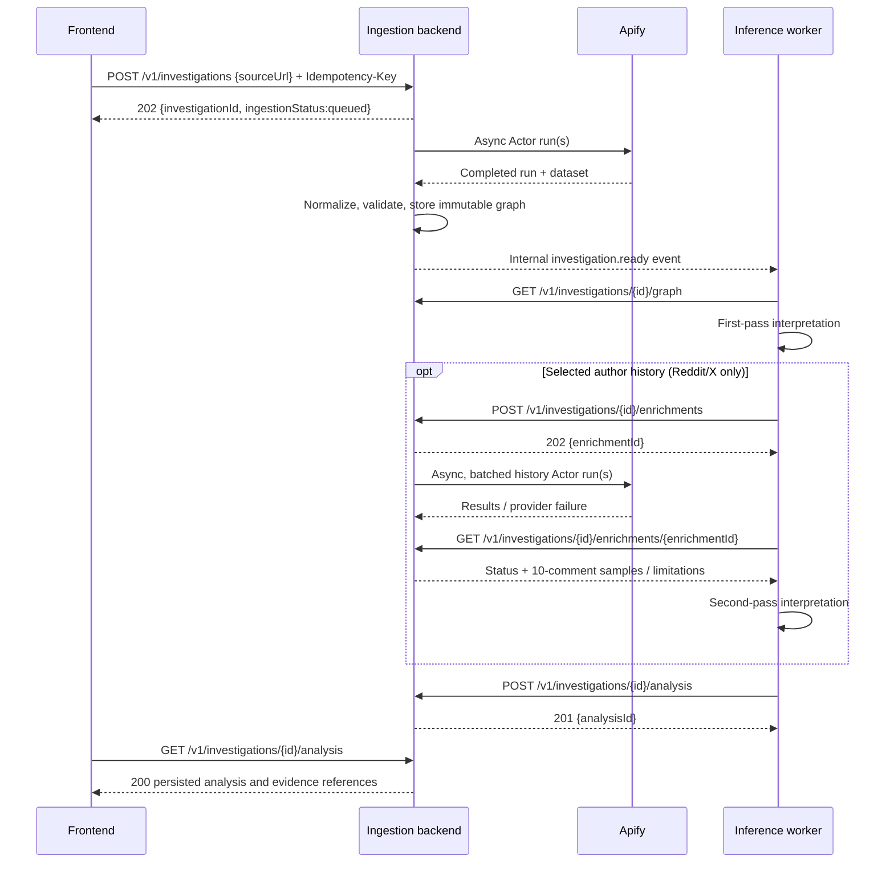

# Discussion Graph & Enrichment API

**Status:** Frozen interface design — **1.0.0**
**Scope:** One public discussion URL per investigation, on Reddit, X/Twitter, YouTube, or TikTok.
**Canonical machine-readable definition:** [`openapi.yaml`](openapi.yaml) + [`models.schema.json`](models.schema.json), JSON Schema Draft 2020-12 / OpenAPI 3.1.0.
**Source:** Supersedes the supplied draft `contracts/discussion-graph-api.md` v0.1. **This is a proposed frozen contract, not proof that both team owners have approved or implemented it.**

## 1. Owners and non-goals

| Component | Owner | Owns | Does **not** own |
|---|---|---|---|
| Ingestion backend | Ingestion owner | URL resolution, Apify Actor invocation, normalization, discussion graph, persistence, author enrichment, provider failures, caching, result storage, API | Who to investigate; identifying astroturfing; scoring |
| Inference worker | Inference owner | Reading graph, choosing accounts and anchor comments, optional enrichment, interpretation, sentiment, anomalies, evidence-backed analysis | Scraper selection, raw provider fields, graph normalization |
| Frontend | Frontend owner | Initiate one investigation, poll state, retrieve graph/analysis, visualize score/cluster/evidence, expose limitations | Calling Apify, user-profile scraping, altering analysis |

A positive opinion about a product is not evidence of deceptive coordination. The service models observable discussion content and supports investigation; it does not prove hidden operator identity or authenticity. Only public/authorized data is in scope, and video/audio analysis is expressly out of scope.

## 2. Frozen decisions (all nine v0.1 open decisions)

1. **Fields and nesting:** `GraphEnvelope` in [`models.schema.json`](models.schema.json) is authoritative. `nodes` is a typed heterogeneous list, `edges` a list of `REPLIES_TO` and `AUTHORED` edges. Node fields remain stable across platforms.
2. **Root:** Exactly one `type: discussion` node; Reddit post, X tweet or YouTube/TikTok video. `rootId` references it. Its `text` is **available text metadata only**; no inference about audiovisual content.
3. **History:** `EnrichmentRequest` has 1–25 author+anchor pairs, `limit:10`, configurable `windowDays` (default clients send 14), and `fallback:'most_recent'`. Per-author status is `complete|partial|unavailable|unsupported|failed`; strategy is `temporal_nearest|recent_fallback|none`. Errors and coverage are explicit.
4. **Async:** HTTP REST; `POST /v1/investigations` and `POST /v1/investigations/{id}/enrichments` return **202 Accepted** and a durable ID. GET endpoints are polled. Apify webhooks/polling are **internal implementation details**. Never hold the client request open while scraping.
5. **Time:** RFC3339 UTC `Z` strings only. Source timestamps are normalized; absent time is `null` with `timestampPrecision:'unknown'`; estimates are flagged, never silently treated as exact.
6. **Analysis:** `AnalysisSubmission` has typed axes, sentiment counts, overall coordination-risk index, comment/cluster findings, evidence references, and `inferredEdges`. All scores use `0–100` or `null`; `confidence` uses `0–1` or `null`. Scores are indices **not calibrated probabilities**. Inferred edges reside **only in analysis**, not the immutable ingestion graph.
7. **Callers:** Frontend creates and reads investigation; backend dispatches an internal `investigation.ready` event to inference when graph is ready. Inference reads graph, requests histories, submits findings. Backend owns persistence; frontend reads the stored analysis. The `investigation.ready` event is defined as `InvestigationReadyEvent` in the canonical schema and includes `eventId`, graph revision, fingerprint and UTC occurrence time.
8. **Errors and versioning:** `/v1` major path, payload `schemaVersion:'1.0.0'`, stable error envelope and status codes. Idempotency required for POST operations. Breaking changes get `/v2`. Backward-compatible optional response additions may bump minor; clients must ignore unfamiliar optional response fields.
9. **Validation:** OpenAPI 3.1 + external JSON Schema Draft 2020-12 models, reproducible fixtures, and [`../scripts/validate_contracts.py`](../scripts/validate_contracts.py). The checker validates structure and selected cross-record invariants; live Actor runs still require separate smoke tests.

## 3. Investigation lifecycle and routes

| Method | Route | Caller | Success | Notes |
|---|---|---|---|---|
| POST | `/v1/investigations` | Frontend | 202 | One source URL; queue ingestion; caller sends `Idempotency-Key` |
| GET | `/v1/investigations/{id}` | Frontend/inference | 200 | `ingestionStatus` and `analysisStatus` independent |
| GET | `/v1/investigations/{id}/graph` | Inference/frontend | 200 | Graph only after ingestion completed; otherwise 409 `NOT_READY` |
| POST | `/v1/investigations/{id}/enrichments` | Inference | 202 | One batch; async; **must** supply anchored graph IDs |
| GET | `/v1/investigations/{id}/enrichments/{enrichmentId}` | Inference/frontend | 200 | Returns results when job `completed`; 200 can contain per-author failures |
| POST | `/v1/investigations/{id}/analysis` | Inference | 201 | One finalized submission per graph revision; matching fingerprint required |
| GET | `/v1/investigations/{id}/analysis` | Frontend/inference | 200 | Before available: 409 `ANALYSIS_NOT_READY` |
| GET | `/v1/capabilities` | Frontend/inference | 200 | Provider support hints; **not** guarantee of run success |

**Status:** `ingestionStatus = queued → running → completed|failed`; `analysisStatus = waiting_for_graph → queued → running → completed|failed`. If ingestion fails, analysis is left `waiting_for_graph` and frontend shows investigation error. Inference may complete without any enrichment. `investigation.ready` delivery is at-least-once and must be deduplicated by `(investigationId, graphRevision)`; delivery failure must be retried. A `POST /analysis` retry with the same idempotency key and body cannot duplicate results.

A graph is immutable for its `(investigationId, graphRevision)`. **Unlike the v0.1 draft, author profiles fetched during enrichment are stored with enrichment evidence, not backfilled into the immutable initial graph.** If an Actor provided profile data during initial ingestion, it may appear on the graph author node from the outset. Refreshing collection requires a **new investigation** in v1; no silent mutation while inference is running. One graph retrieval returns the entire normalized dataset (no pagination in v1), and implementations must set acceptable compressed response and size limits before deployment. Extremely large discussions may fail with `DISCUSSION_TOO_LARGE` rather than being presented as a complete graph; a truncated graph can also be accepted explicitly with coverage marked partial. The backend's chosen bound is a deployment policy, not part of the API's wire format.

## 4. Graph identity, hierarchy, and coverage invariants

- IDs follow `<platform>:<kind>:<native-id>` where `kind` is `discussion`, `author`, or `comment`. The provider's identifier is preserved in `nativeId` and **always serialized as a string**. Synthetic IDs, if a provider ID is missing, use `<platform>:comment:synthetic:<hash>` with `idQuality:'synthetic'`; do not pretend synthetic IDs are globally stable. Author IDs built from handles use an explicit `identityQuality:'handle'` and may change.
- Exactly one root discussion node, exactly one node for each included identifier; all nodes must match the investigation's `platform`. Every edge endpoint must exist. `REPLIES_TO` goes comment → comment/discussion; `AUTHORED` goes author → comment. There is no edge for an unavailable parent; preserve `nativeParentId`. Root-level comments attach to discussion root even when a scraper emits null parent IDs.
- `authorId = null` for anonymous/deleted/unresolvable commenters. **Never merge all `[deleted]` Reddit authors** under one synthetic identity. Repeat commenters with verifiable IDs share one author node.
- `createdAt` is nullable; `timestampPrecision` must flag estimated values. `sourceTimestamp` preserves a raw source string for comments; absolute UTC normalization is mandatory.
- `metrics` contains only observed platform values; score/karma can be negative; absent metrics are absent, not zero. Preserve comment evidence URLs when offered. Original post/video text comes from text metadata only (`contentScope`).
- `coverage.retrievedCommentCount` is the number of unique retained comment nodes, **not the number of all discussion comments**. `reportedCommentCount` may be null, and `truncated` may be null if unknowable. `completeness:'complete'` is permitted only with independent evidence of exhaustive retrieval; a successful Apify run is insufficient. Record sort order, platform constraints, missing replies, timestamp precision, run provenance, collection time and raw snapshot reference.
- Raw Apify output is stored in the backend's protected snapshot store; the returned `sourceSnapshotRef` is an opaque lookup key, never an exposed Apify access token or unrestricted dataset URL.

### Retained-result reuse

Creating an investigation may reuse retained work for the same canonical platform/post identity and compatible collection policy. A completed hit returns the existing completed state with HTTP 202; an in-flight hit follows the existing work without another provider run or ready event. Different principals receive separate owner-scoped, read-only investigation views; original IDs remain inaccessible. View graphs have consistently recomputed fingerprints, and their analysis/enrichment resources reference the view. Stored source content is not duplicated or modified. A write to a reused view returns 409 `INVESTIGATION_REUSED`; inference writes target the original investigation.

Reuse and view expiry never exceed the backing investigation's original 24-hour deadline. Source removal or missing required evidence invalidates reuse. Normal request idempotency and per-principal rate limits remain unchanged. Collection timestamps remain original so the frontend can show data age.

## 5. Author-history sampling algorithm

**Inference chooses the author; ingestion chooses the historical sample.** `authors[]` entries must reference a graph author and a graph comment authored by that author; mismatch is a 422. Duplicate identical `(authorId, anchorCommentId)` pairs in one request are rejected with 422 `DUPLICATE_AUTHOR_ANCHOR`; multiple distinct anchors for the same author are allowed. Deduplicate provider lookups by author but produce one result per accepted pair. For user-selected authors from YouTube or TikTok, return `unsupported` without invoking Apify.

For Reddit/X, the ingestion backend:

1. Collects a best-effort candidate set of the selected author's *public, authored comments/replies* (not comments other users left under their own posts). Target up to 150 candidates per author; this is a **collection budget**, not a lifetime-history guarantee. Cache provider result by platform, author, candidate retrieval policy, and freshness.
2. Excludes comments from the **focal discussion** and the anchor comment itself. Deduplicates by provider comment ID. Rejects future-dated erroneous timestamps; comments without parseable timestamps can be returned in neither time-adjacent nor recent sample.
3. If **at least 10** candidates fall within ±`windowDays` × 24 hours of the anchor timestamp, returns the 10 closest, ordered by absolute time distance, ties by newer time first, then string ID ascending, with `strategy:'temporal_nearest'`.
4. If fewer than 10 fall in that window, returns the **10 most recent available distinct** candidates (`strategy:'recent_fallback'`), even if some would have fallen in the window. This is a complete *fallback replacement*, not a blend. If the candidate pool is empty, strategy is `none`.
5. Returns normalized historical comments, optional Reddit `accountCreatedAt`, `postKarma`, `commentKarma`, coverage of *retrieved candidate pool*, and any per-author errors. Marks `status:'complete'` **only when 10 requested items were returned**, not when the user's lifetime history is known complete. Fewer than 10 → `partial` (unless unsupported, inaccessible, or provider failure). An empty provider result is **not** proof that the user has no historical comments.

When timestamp precision is `estimated`, temporal sampling may be inappropriate; use recent fallback or return `partial`, explaining the limitation. If the Actor can only collect newer content and did not reach the anchor period, set `reachedAnchorWindow:false` and include limitation; do not label the sample a statistically representative history. The engine can request zero enrichment jobs and still submit analysis.

| Per-author `status` | Semantics |
|---|---|
| `complete` | All 10 sample items returned; provider history may still be truncated |
| `partial` | Fewer than 10 usable items or incomplete candidate retrieval, but some response is available |
| `unavailable` | Account/content cannot be retrieved (e.g., hidden, deleted, access restricted) |
| `unsupported` | No arbitrary authored-comment history support for this platform in v1 |
| `failed` | Transient/permanent provider error during this author's retrieval; error describes retryability |

An enrichment **job** is `completed` once every requested author has a terminal per-author result, even if some authors are `partial`, `unavailable`, `unsupported` or `failed`. Only unrecoverable **job-level** faults result in job `failed`.

## 6. Inference result contract and statistical meaning

`AnalysisSubmission` requires exact `graphRevision` and `graphFingerprint` echoed from `getGraph`, an inference model/version label, interpreted `subject` (product, service, idea, brand, other, unknown), and all typed result collections. All assertions cite node IDs; evidence must resolve to the graph or to stored history returned by a `usedEnrichmentIds` job. Unknown or fabricated evidence IDs are rejected with `INVALID_EVIDENCE_REF`.

| Field | Semantics |
|---|---|
| `sentiment.counts` | Number of **analyzed comments** supportive/critical/neutral/mixed/unclear **toward the extracted subject**. Counts sum to `analyzedCommentCount`. No claim about unique people unless modeled separately. |
| `sentiment.population` | `retrieved_comments` if all retrieved comments were analyzed; otherwise `analyzed_sample`. Never call an arbitrary/biased scrape an entire population. |
| `sentiment.method` | `census_of_retrieved`, `probability_sample`, or `nonprobability_sample`. A selection chosen for suspiciousness is nonprobability. |
| `overallCoordinationRisk` | 0–100 heuristic index or `null`; not a probability of a coordinated campaign or a verdict of fraud. |
| `axes` | `promotional_intent`, `semantic_coordination`, `temporal_coordination`, `account_anomalies`, `engagement_anomalies`, `disclosure_concerns`. `promotional_intent` is **not** interchangeable with coordination risk. |
| `commentAssessments` | Optional per-comment stance and promotional intent; target must be a graph comment. |
| `commentAssessments[].accountSignals` | Optional (added 2026-10-24, backward compatible). Automation-signal index (0-100 or null) for the comment's author from their sampled history, with the rubric family-B rules that fired and their evidence. Attached to the author's anchor comment. An uncalibrated index of observed signals, not a probability that the account is automated; never label an account a bot. When `humanSignals` lists evidence of an ordinary user (E2, E4, E7), `signals` is empty and `score` is 0. Consumers that do not know the field ignore it. |
| `clusters` | Groups of at least two graph comment IDs with evidence; membership does not assert accounts share an operator. |
| `inferredEdges` | Analysis-only comment↔comment relationships of type `SEMANTICALLY_SIMILAR` or `POTENTIALLY_COORDINATED`, strength 0–1, never merged into graph. |
| `usedEnrichmentIds` | Enrichment jobs used to reach conclusions, for evidence validation and frontend retrieval. |
| `limitations` | Insufficient sampling coverage, missing histories, timestamp uncertainty, untested heuristics and other relevant caveats. |

An axis `score=0` means model-observed lowest index on that axis; **`score=null` means insufficient evidence or no measurement**. `confidence` is model confidence, not a statistical confidence level or an independently calibrated probability. If the model sampled just the most suspicious accounts, it cannot infer that those accounts represent the whole discussion without a defined probability-sampling design and weights.

## 7. Errors, access and compatibility

All errors follow `{ "error": {"code", "message", "retryable", "requestId", "details"?} }`. Jobs expose eventual provider failures in their resource, not as a failed GET HTTP request. Standard responses:

| HTTP | Examples |
|---:|---|
| 400 | `INVALID_REQUEST`, `INVALID_URL` (unsupported domains, invalid syntax) |
| 401 / 403 | `UNAUTHORIZED`, `FORBIDDEN` |
| 404 | `INVESTIGATION_NOT_FOUND`, `ENRICHMENT_NOT_FOUND` |
| 409 | `NOT_READY`, `ANALYSIS_NOT_READY`, `STALE_GRAPH_REVISION`, `ANALYSIS_ALREADY_SUBMITTED`, `IDEMPOTENCY_CONFLICT`, `INVESTIGATION_REUSED` |
| 422 | `ANCHOR_AUTHOR_MISMATCH`, `DUPLICATE_AUTHOR_ANCHOR`, `UNKNOWN_AUTHOR`, `UNKNOWN_ANCHOR`, `INVALID_EVIDENCE_REF`, `INVALID_ANALYSIS` |
| 413 | `DISCUSSION_TOO_LARGE` (configured graph-size guard) |
| 429 | `RATE_LIMITED` (honor `Retry-After` when set) |
| 500 | `INTERNAL_ERROR` |

`Idempotency-Key` on **every POST** is 8–128 ASCII characters; dedupe by authenticated principal + route + key for 24 hours. Same key and semantically identical body replays original success; same key with changed body returns 409. Write roles are separate (`frontend` for create, `inference` for enrich/submit); reads are authorized per investigation. Bearer tokens only; the Apify token stays server-side. Restrict inbound target domains and disallow redirects into private/internal network addresses to avoid SSRF. Do not access private/protected accounts or bypass platform access controls.

Clients ignore optional response properties they do not recognize; clients send only defined request fields. New optional fields/enum values require compatibility review; breaking changes use `/v2`, not silent reinterpretation. API consumers can inspect the exact `schemaVersion` returned. Contract fixtures use synthetic URLs/accounts and must never be passed off as real investigations.

## 8. Remaining operational verification (not schema decisions)

Before demo, run one actual Actor call for each platform and inspect nested replies, provider IDs, author IDs, timestamps, source URLs and paging. Validate Reddit profile metadata separately if you want karma and creation dates. Cross-check X reply/history behavior; a profile Actor's `getReplies` often retrieves replies **to** that account's posts, not the account's own authored replies. Ensure timestamp conversion (e.g. Twitter's legacy date strings) is correct. Follow platform data terms; Apify availability alone is not legal access authorization.

The wire contracts are specified; **live Actor correctness, author-history coverage, actual schema mappings, consent/authorization, deployment size limits, and team acceptance are still prerequisites for operational readiness.**
